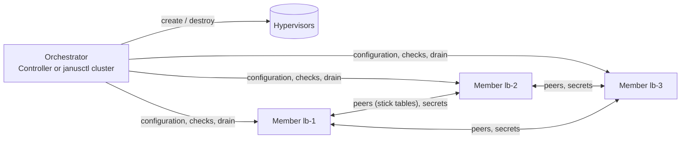

# Clusters: a design

Several Janus nodes serving the same traffic as one cluster: the same
HAProxy configuration on every member, stick tables replicated between
them with HAProxy's `peers`, certificates and keys carried from member
to member without ever passing through the Controller, members
replaced one at a time without a dropped connection, and - where the
failover mode spreads the load - members added and removed with it.
This page is the design: what a cluster is, how one is created, checked,
kept in sync, recycled and scaled, and what HAProxy does and doesn't
know about it. It ends with the related, simpler case of replacing a
standalone node by a new one with its configuration and certificates.

> [!NOTE]
> This is a design, not a feature. Nothing on this page is implemented
> yet; the API names, paths and figures are proposals, and the page
> says where they depart from what exists today. It is kept out of the
> docs site until the first phase ships.

## In short

- A **cluster** is a set of nodes with one shared configuration
  (HAProxy, VRRP, BGP, firewall), one HAProxy `peers` group for their
  stick tables, and - depending on its failover mode - virtual IPs
  (VRRP) or an anycast announcement (BGP/ECMP).
- The **orchestrator** - the Controller, or `janusctl cluster` for a
  fleet without one - holds the cluster's desired configuration and
  pushes it to every member. Members don't elect anyone and keep no
  quorum: they talk to each other only for HAProxy's peers protocol and
  to pull secrets from one another.
- **Keys never leave the nodes.** A member's certificate comes from a
  signing request its own key made; HAProxy's uploaded certificates,
  the ACME certificates and the TLS ticket keys travel from member to
  member over mTLS, never through the Controller, never into a log.
- **Nothing is built on a node.** janusd generates the `peers` section
  from the composition the orchestrator gives it; the operator's
  `haproxy.cfg` stays theirs, and so does its history.
- **Every step is checked and reversible**: joining, syncing, recycling
  and scaling each have blocking checks before, an observed state
  after, and a rollback.
- **Horizontal auto-scaling fits BGP/ECMP**, where every member serves;
  a VRRP pair gets no capacity from a third node, so it keeps the
  existing [vertical auto-scaling](guide/auto-scaling.md) instead.

## What a cluster is

A cluster is a group of nodes that **serve the same traffic with the
same configuration**. What makes them one cluster rather than a pair of
look-alike nodes:

- the configuration is written once and applied to all of them, with
  per-member values (a VRRP priority, a BGP router ID) filled in;
- their HAProxy processes replicate their stick tables - sessions,
  counters, rate limits - so a failover or a new member finds them
  full;
- their TLS material is the same, so a client resuming a TLS session or
  pinning a certificate sees one service;
- a member can be taken out, replaced or added while the others serve.

Three parties take part:

| Party | Who | What it does |
|---|---|---|
| **Member** | janusd on each node | Holds its membership and member certificate on STATE, generates the `peers` section, serves the primitives (join, status, pull, drain, leave) |
| **Orchestrator** | The Controller, or `janusctl cluster` for a [fleet without a Controller](fleet-without-controller.md) | Keeps the desired configuration, runs the checks, applies, reconciles, recycles, scales |
| **Hypervisor** | libvirt/KVM or Proxmox VE through the Controller ([hypervisors.md](hypervisors.md)) | Creates and destroys member VMs, keeps them on different hosts |

The design keeps the project's rules ([architecture.md](architecture.md)):
no shell and no generic "run this" RPC - every primitive is a narrow,
typed call; features optional at the image level - a node without
`keepalived` or `bird` has no VRRP or BGP to sync; every dangerous
action streams its progress and can be rolled back; the Controller
never stores a node's root credential, and a node never sends one.



## 1. Identity

**The cluster** has two names:

- `id`: a UUID (version 4), generated when the cluster is created,
  never changed. It is unique by construction, across Controllers and
  fleets.
- `name`: chosen by the operator, a DNS label
  (`^[a-z0-9]([a-z0-9-]{0,30}[a-z0-9])?$`, 32 characters at most),
  unique within its orchestrator. Renaming is allowed; the `id` is
  what everything else refers to.

**A member** has a name too: a DNS label of 63 characters at most,
unique within the cluster. It is the node's hostname by default - a
node adopted into a cluster keeps it. Members the orchestrator creates
are named `<cluster>-<n>`, `n` counting up and never reused: a
replacement is a *new* member, with a new name, because the old and
the new one are both HAProxy peers for a while (section 5).

Where the identity shows:

| Where | What |
|---|---|
| The member certificate (section 2) | `CN=<member>`, `O=janus:cluster`, a SAN URI `janus://cluster/<id>/member/<member>` and a SAN DNS `<member>` |
| HAProxy | `-L <member>` on its command line: the local peer name; `server <member>` lines in the generated `peers` section; `show peers` |
| The node's STATE | `cluster/cluster.json` (the composition), `cluster/member.pem`, `cluster/ca.pem` |
| The node's metrics | `janus_cluster_info{cluster_id, cluster_name, member} 1`, and `janus_haproxy_peer_*` (section 7) |
| The node's events and shipped logs | `cluster.*` events; a `cluster` field (id and name) on every line sent by [log forwarding](guide/log-forwarding.md), so a target can group a cluster's members |
| The Controller | `/api/clusters/{id}`, the cluster's page, `clusters/<id>/` in its data directory |
| Terraform | a `janus_cluster` resource keyed by `id` |

`common.proto`'s `Metadata{hostname}` - per-response node identity
reserved for a multi-node proxy - stays unused: the cluster identity
goes in the cluster messages themselves.

## 2. Creating a cluster

### What a member knows

A member keeps, on STATE under `cluster/`:

- `cluster.json`: the cluster's id and name, its own member name, the
  list of members (name, peers address, API address), which
  configuration domains the cluster manages (section 4), and the
  `managed_by` stamp of the last apply;
- `member.pem`: its member certificate, its chain and **its private
  key, generated on the node** (mode 0600, never served by the file
  RPCs - the path joins `SecretPaths`);
- `ca.pem`: the cluster's CA certificate(s) it accepts (below);
- `tls-ticket-keys`: HAProxy's TLS ticket key ring (section 4).

The primitives are a new `ClusterService` in
`api/proto/janus/v1alpha1/cluster.proto`, each RPC with its own leading
comment and a `requiredRoles` entry like every other one:

```proto
service ClusterService {
  // ClusterGet returns what this node knows of its cluster: id, name,
  // its member name, the members and their addresses, the managed
  // domains - nothing secret.
  rpc ClusterGet(ClusterGetRequest) returns (ClusterInfo);                    // readers
  // ClusterSet installs or updates the membership: the cluster CA, this
  // node's member certificate (its key was made here, see
  // SystemService.CertificateRequest), the member list. janusd
  // regenerates the peers section and reloads HAProxy; a certificate
  // alone is swapped at runtime without a reload.
  rpc ClusterSet(ClusterSetRequest) returns (ClusterInfo);                    // admin
  // ClusterLeave forgets the membership: peers section back to the
  // local peer alone, member certificate and ticket keys deleted,
  // managed domains unlocked. Doesn't drain: call ClusterDrain first.
  rpc ClusterLeave(ClusterLeaveRequest) returns (ClusterLeaveResponse);       // admin
  // ClusterStatus reads HAProxy's "show peers": each peer up or down,
  // its last handshake, and for each table whether this node is still
  // teaching or learning it. Carries this node's clock for skew checks.
  rpc ClusterStatus(ClusterStatusRequest) returns (ClusterStatusResponse);    // readers
  // ClusterDrain takes this member out of service without stopping it:
  // marks HAProxy unhealthy for keepalived and BIRD (the virtual IPs
  // move, the routes are withdrawn) and reports when they have.
  rpc ClusterDrain(ClusterDrainRequest) returns (stream ClusterDrainProgress); // admin
  // ClusterUndrain puts it back.
  rpc ClusterUndrain(ClusterUndrainRequest) returns (ClusterUndrainResponse); // admin
  // ClusterPull makes this node fetch secrets from another member,
  // over mTLS with its member certificate: HAProxy's uploaded
  // certificates, its files, the ACME certificates, the ticket key
  // ring. Streams what was pulled, never the content.
  rpc ClusterPull(ClusterPullRequest) returns (stream ClusterPullProgress);   // admin
  // ClusterExport serves ClusterPull. Only a member certificate of
  // this very cluster is accepted - no user role opens it.
  rpc ClusterExport(ClusterExportRequest) returns (stream Data);              // cluster member
  // TLSTicketKeysRotate adds a key to the ring and hands it to HAProxy
  // without a reload. The other members pull the ring afterwards.
  rpc TLSTicketKeysRotate(TLSTicketKeysRotateRequest) returns (TLSTicketKeysRotateResponse); // admin
}
```

One more RPC belongs to `SystemService`, shared with the standalone
replacement at the end of this page:

```proto
// CertificateRequest makes a new private key on the node for the given
// purpose and returns a signing request for it. The key never leaves
// the node: the caller signs the request and brings the certificate
// back (ClusterSet, StateImportFrom). The same shape as
// ACMECertificateRequest.
rpc CertificateRequest(CertificateRequestRequest) returns (CertificateRequestResponse); // admin
```

The authorization table gains one role class: `cluster member`. A
certificate with `O=janus:cluster` opens `ClusterExport` and the peers
port, nothing else, and only when its SAN URI names this node's own
cluster.

**Trust between members.** HAProxy's `peers` listener verifies a
client's certificate against a CA file and nothing more: it can't check
a name or a URI. So the anchor that file holds must be one that only
this cluster's members chain to. Each cluster therefore gets **its own
CA**, generated by the orchestrator when the cluster is created (ECDSA
P-256 like every other key in Janus, 10 years), its key sealed with the
Controller's master key - or in janusctl's configuration directory
next to `issuing.key` for a fleet without a Controller - and backed up
with the rest. Members pin it: `ClusterSet` brings it, from a caller
who proved admin rights on the node, the way a node pins its fleet root
once. janusd's `AcceptChains` accepts one more kind of chain, anchored
on `cluster/ca.pem`, for the member role only. Rotation is an overlap:
`ca.pem` holds both CAs while members are re-signed, then the old one
is dropped. The fleet stays the prerequisite in practice - the
orchestrator reaches every member as a fleet admin - but the cluster's
own trust doesn't hang on the fleet's issuing CA, because HAProxy
couldn't tell one fleet certificate from another.

Member certificates last 30 days; the orchestrator renews them at two
thirds, with a `ClusterSet` that carries the certificate alone - HAProxy
takes the new one at runtime (`set ssl cert` + `commit ssl cert`), no
reload.

### On a hypervisor

A cluster created from the Controller names its members' machine
specification once (vCPUs, memory, image, extensions, NICs - the same
`Spec` a machine has today, [hypervisors.md](hypervisors.md)) and the
hypervisors it may use. The Controller creates N machines through the
existing path - image, NoCloud volume with a one-time registration
token, admission - then runs the checks, syncs, and brings each member
into the peers group.

**Anti-affinity** - never two members of one cluster on the same
physical host. The Controller can only honour it when it knows which
host a hypervisor record *is*:

- a libvirt record is one SSH target, one `libvirtd`: one host. Two
  records can point at the same machine, so the driver's `HostInfo`
  gains a `HostID` - libvirt's hostname plus the host's SMBIOS UUID
  (`NodeGetSysinfo`) - and two records with the same `HostID` count as
  one host;
- a Proxmox record targets **one PVE node** (`/nodes/<node>/...`,
  the token's rights end there): `HostID` is the PVE cluster name
  (`/cluster/status`) plus the node name. A cluster of N members on
  Proxmox needs N records on N nodes until a record can span a PVE
  cluster - a later extension, with a `VM.Migrate` right it doesn't
  have today;
- VMware has no driver yet; when it comes, anti-affinity maps to a DRS
  rule.

The cluster's `anti_affinity` is `required` by default: with fewer
distinct hosts than members, creation is **refused** before anything
is made, naming the hosts it found. `preferred` places what it can and
**warns** on the cluster's page for every pair sharing a host; `off`
doesn't look. Standalone nodes adopted into a cluster have no known
host: `unknown`, a warning, never a refusal.

Placement is observed, not assumed: `MachineStatus` gains the host the
VM runs on, the machine sync loop records it, and the cluster's status
warns when two members end up together - a Proxmox HA migration moves
a VM without asking, and today the Controller wouldn't notice.

### From existing nodes

Nodes already deployed - installed by hand, by Terraform, by the
Controller - can be grouped. The operator picks them, the checks run
(section 3), and chooses **one member as the source**: its current
configuration becomes the cluster's desired configuration, applied to
the others after a diff of what each one loses. A cluster can also
start from an empty desired configuration, every member keeping its
own until the first cluster apply - for grouping nodes whose
configurations already match.

### Joining a node to another

A standalone node becomes a two-member cluster by joining a second one
to it: the same path as above with two nodes, the existing one the
source. It is the common way to start: one node today, a cluster next
month.

All three are the same two calls: `POST /api/clusters` (name, failover
mode, machine specification or member list, source) and
`POST /api/clusters/{id}/members` (a new machine, or an existing node).
A member leaves with `DELETE /api/clusters/{id}/members/{name}`, which
drains it first unless it's already gone.

```mermaid
sequenceDiagram
    accTitle: Joining a node to a cluster
    accDescr: The orchestrator checks the node, obtains a signing request from it, signs a member certificate with the cluster CA, installs the membership on the node and on the other members, has the node pull the secrets from a member, applies the configuration and waits for the stick tables to be learnt.
    participant O as Orchestrator
    participant N as New member
    participant M as Existing member
    O->>N: checks (version, schematic, health, probes to M)
    O->>N: CertificateRequest(CLUSTER_MEMBER)
    N-->>O: CSR
    O->>N: ClusterSet(cluster CA, member cert, members)
    O->>M: ClusterSet(members + N)
    Note over N,M: both reload HAProxy; peers connect over mTLS
    O->>N: ClusterPull(from M: certs, files, ACME, ticket keys)
    N->>M: ClusterExport (member cert)
    O->>N: apply desired configuration (section 4)
    O->>N: ClusterStatus until tables learnt
    Note over N: in service (VRRP priority, BGP routes)
```

## 3. Checks

One check set, `cluster.Check`, runs **before** creating, joining,
recycling or scaling (its blocking findings refuse the operation) and
**after** every apply (its findings are the cluster's state, on its
page and in `janus_cluster_check{check, severity}`). The checks read
what the API already exposes - `Version`, `ShowInfo`, `VRRPStatus`,
`BGPStatus`, `FirewallGetRuleset`, `Probe` - and the rendered
configurations.

**Blocking:**

| Check | How |
|---|---|
| Fleet trust | Every member trusts the orchestrator's fleet (`TrustGet`): the orchestrator must reach it as an admin |
| Same image | The same schematic ID on every member (`Version.schematic_id`): the same extensions, HAProxy branch and kernel track. A cluster changes image by recycling (section 5) |
| HAProxy healthy | `ShowInfo` answers and the manager is serving; no pending boot confirmation on the node |
| Member names | Unique, valid labels; the node's hostname when not given |
| Reachability | From each member to each other: TCP to the peers port (`10057`) and to the API (`9505`), both ways, with `SystemService.Probe` - the operator's nftables ruleset is checked by the fact, not by parsing it |
| VRRP | For each `vrrp_instance` name across the rendered files: the same `virtual_router_id` and `interface`, distinct `priority`, the same `authentication` block; `VRRPStatus` after the apply confirms one MASTER per instance - two MASTERs mean the adverts (IP protocol 112, multicast `224.0.0.18` or the unicast peers) don't pass between the members, which `Probe` can't test itself |
| BGP | The same `local_as` on every member, distinct `router_id`s; `BGPStatus` after the apply shows every `haproxy_*` protocol established |

**Warnings:**

| Check | How |
|---|---|
| Version skew | Members on different releases - tolerated, a rolling update passes through it, but flagged until it ends |
| Latency | Round-trip between members above 50 ms (`Probe` ping): stick-table replication lags |
| Clock skew | Clocks more than 5 s apart (`ClusterStatus` carries the node's time): table expiries and logs disagree |
| Placement | Two members on one host, or a member whose host is unknown |
| LOGS | A member without a LOGS partition (installed before it existed): its logs don't survive a reboot |
| BGP announcements | Members exporting different route sets (`BGPStatus` channels, a `BGPRoutes` RPC listing `show route export`) - legitimate when ToR peerings differ, worth a look |
| Peers TLS | A member certificate past two thirds of its life that the orchestrator failed to renew |

A check that can't run - a member unreachable - is a finding of its
own, blocking for a join and a recycle, a warning for a status.

## 4. Synchronisation

### The desired configuration

The orchestrator holds the cluster's configuration, **versioned**:
`clusters/<id>/desired/v<N>/` in the Controller's data directory, or
the directory `janusctl cluster` is pointed at. A version holds:

- `haproxy.cfg`;
- HAProxy's files that aren't secrets ([haproxy-files.md](haproxy-files.md):
  maps, ACL files, error pages, CA bundles);
- `keepalived.conf`, `bird.conf`, `firewall.nft`, each present only
  when the cluster's image has the extension;
- the member values: a `vars` map per member (`priority`, `router_id`,
  anything the templates name) and the per-member peers address.

The daemon files are **templates** (Go `text/template`, `{{ }}`
delimiters; a literal `{{` is written `{{ "{{" }}`) rendered by the
orchestrator for each member, so the node keeps receiving plain text
checked by the daemon itself, as today. What a template can use:
`.Cluster.ID`, `.Cluster.Name`, `.Member.Name`, `.Member.Index`,
`.Member.Address`, `.Member.Vars.<key>`, and `.Peers` (the other
members). The VRRP pair of [networking.md](private-cloud/networking.md)
becomes one file for any number of members, with unicast peers filled
in:

```text
track_file haproxy {
    file /run/janus/keepalived/haproxy-health
}

vrrp_instance front {
    state BACKUP
    interface front
    virtual_router_id 51
    priority {{ .Member.Vars.priority }}
    advert_int 0.2
    unicast_src_ip {{ .Member.Address }}
    unicast_peer {
    {{- range .Peers }}
        {{ .Address }}
    {{- end }}
    }
    track_file {
        haproxy weight -100
    }
    virtual_ipaddress {
        192.0.2.100/24
    }
}
```

`haproxy.cfg` is not a template: HAProxy's own `-L` and the generated
`peers` section (section 7) give it what differs per member, and the
file stays byte-for-byte what the operator wrote - on every member, in
every member's history, in `GetConfig`.

### Applying

An apply is one version, pushed **one member at a time**, in this
order on each: `ValidateConfig`/`validate_only` of everything first;
then HAProxy (`ApplyConfig` keeps the previous configuration when the
new process fails to start); the firewall, on trial, confirmed from a
fresh connection once the member answers; VRRP; BGP. The first failure
stops the apply: the members already done keep the new version, the
others the old, the cluster shows **partially applied** with the
member and the error, and the operator either fixes and re-applies or
rolls back - which is an apply of `v<N-1>`. A member reached in the
middle of a rolling update (version skew warning) is applied like the
others: a configuration is for a schematic, not a release.

A new version is a diff on the cluster's page before it goes, like a
node's configuration today; `haproxy -c` runs on the first member's
copy before any member is touched.

### Locks and drift

Each member records which domains its cluster manages
(`cluster.json`: `haproxy`, `files`, `vrrp`, `bgp`, `firewall`). A
write to a managed domain that doesn't come from the orchestrator -
`ApplyConfig`, `FilePut`, `VRRPApplyConfig`... called with a user's
certificate, or from the node's page - is refused with
`FailedPrecondition: managed by cluster <name>`; the orchestrator's
calls carry the metadata `janus-cluster-apply: <id>`. The lock can be
**released** per member and per domain (the cluster's page, `janusctl
cluster release`) for an emergency change on one node - an audited,
journaled event - and the member is then in **drift**: the
reconciliation loop sees a `managed_by` stamp (`janus-cluster <id>
v<N> <sha256[:8]>`) or a content hash that doesn't match, says so, and
**never overwrites it on its own**. The next cluster apply does, with
a warning naming the drifted member. This is the Terraform `lock_ui`
precedent (a 423 on the page, releasable on the card) with the same
rule for everyone, and the opposite of log-forwarding profiles, which
re-apply silently: an HAProxy configuration someone changed by hand on
a production node is not something a loop should undo.

The reconciliation loop is the log-forwarding one's shape: every 10
minutes, every minute while a member is in error, at once when the
cluster changes. It re-applies a version a member missed (it was down,
or new), reports drift, renews member certificates, and runs the
status checks.

### Secrets: member to member

Four things on a node are secrets the cluster must share and the
orchestrator must never see:

- HAProxy's uploaded certificates (`haproxy/runtime-certs/`);
- its files that hold a private key (`haproxy/files/`);
- the ACME certificates (`haproxy/acme/*.pem`, chain and key);
- the TLS ticket key ring (`cluster/tls-ticket-keys`).

They move **from member to member**: the orchestrator names the source
- the member where the operator uploaded the certificate, the member
that orders from the CA - and calls `ClusterPull{from: <member>,
items}` on each other member. The puller dials the source's API with
its member certificate; the source's `ClusterExport` checks the
certificate chains to the pinned cluster CA and names this cluster,
and streams the items. Transit is the members' mTLS; at rest they land
where they already live, mode 0600, written through a temporary file,
fsync and rename. The orchestrator sees the list of what moved and
nothing of it; the node's audit records the call, never the content;
no log line ever carries a key - the export stream is handled by code
that has no logger. STATE isn't encrypted at rest today and this
design doesn't change that: encrypting STATE is its own roadmap item.

When a certificate is uploaded to a member through the cluster's page,
the orchestrator uploads to one member and pulls on the others; an
upload made on a member directly is refused by the lock above, so
there is one way in.

### Let's Encrypt in a cluster

The [letsencrypt extension](letsencrypt.md) obtains certificates per
node. In a cluster, one member - or the Controller, in its
`CONTROLLER_ORDERED` path ([letsencrypt-controller.md](guide/letsencrypt-controller.md))
- is the **orderer**; the others pull its certificates at each
renewal, so every member serves the same certificate under the same
key. HTTP-01 works behind the shared address because every member
answers with the orderer's account thumbprint: in the Controller's
path they already do; with a member ordering, the cluster's ACME
configuration carries the shared account key (`account_key`, write-only
as today). The orderer's renewal is a cluster event the loop reacts to
with pulls, and the cluster's page shows one certificate list, not N.
A cluster may instead let every member order its own - the choice
today - at the cost of the CA's duplicate-certificate limit (five a
week for the same names at Let's Encrypt) and of a different
certificate on each member; the page says which it is.

### TLS ticket keys

A TLS session resumes with a ticket the server encrypted; a client that
lands on another member - after a failover, under ECMP - can only
resume if that member holds the same key. HAProxy reads a key ring
from a file (`tls-ticket-keys` on a `bind` line, three keys or more)
and takes a new key at runtime (`set ssl tls-key`), no reload. Without
the file, each HAProxy process makes its own random key: resumption
breaks at every reload too, cluster or not.

janusd keeps the ring at `cluster/tls-ticket-keys`, standalone or not:
a standalone node's reloads stop breaking resumption, which is the
feature's first use. In a cluster, the ring is one of the pulled
secrets: the orchestrator calls `TLSTicketKeysRotate` on the orderer
member every 24 hours and `ClusterPull` on the others; a key stays in
the ring for three rotations, so a member that missed one still
decrypts. The operator opts in by naming the file on their `bind`
lines; nothing changes for a configuration that doesn't.

The ring is necessary but not sufficient: HAProxy binds a session's
ticket to the **certificate** that served it, so a session resumes on
another member only when that member serves the same certificate on its
frontend as well as holding the same keys. Behind a cluster's shared
address every member serves the same public certificate - an uploaded
one pulled between members, or the orderer's Let's Encrypt one - so the
two travel together; a member's own `peers` certificate, which differs
per member, is not what the public frontend presents.

> [!NOTE]
> HAProxy built on AWS-LC takes `tls-ticket-keys` and resumes a TLS 1.2
> session across processes that share the ring and the certificate
> (verified on the release's 3.4 binary). A TLS 1.3 session resumes the
> same way; `openssl s_client -sess_out` only captures one after the
> post-handshake ticket, so `make qemu-cluster-test` checks with TLS 1.2.

## 5. Recycling members

Recycling replaces a member by a new one - a newer image, a different
disk layout (a LOGS partition where there was none), a VM moved to
another host, or simply a fresh node - **without a dropped
connection**. `POST /api/clusters/{id}/recycle` names the members to
replace (all, or some) and runs them one at a time; the cluster's
image or machine specification can change with it, which is how a
cluster changes schematic. The in-place A/B update ([updates.md](guide/updates.md))
stays the way to change release without a new VM.

For each member, in order:

1. **Create the replacement**: a new machine from the cluster's
   specification (anti-affinity included: the old member's host is
   taken as long as the old member exists), a new member name.
2. **Join it** (section 2): checks, membership, `ClusterPull`,
   desired configuration. The new HAProxy, with no local process to
   learn from, asks a remote peer for a **full resync** of every table
   at start - this is HAProxy's own behaviour.
3. **Checkpoint - learnt**: `ClusterStatus` on the new member shows
   every table's learning finished and acknowledgements advancing. Its
   VRRP instance is BACKUP with its configured priority; its BGP
   protocols are established and enabled.
4. **Drain the old member**: `ClusterDrain` writes `1` into
   `/run/janus/keepalived/haproxy-health` (keepalived drops the
   priority by the operator's `track_file` weight and a peer preempts
   the virtual IP - the same path a reboot takes today, [vrrp.md](vrrp.md))
   and `disable`s the `haproxy_*` BIRD protocols (the routes are
   withdrawn, the same gate as an unhealthy HAProxy, [bgp.md](bgp.md));
   it streams until `VRRPStatus` shows the instances in BACKUP and
   `BGPStatus` shows the protocols down, then HAProxy is soft-stopped
   with the usual drain delay: listeners stay open while the routers
   converge, established connections finish.
5. **Checkpoint - drained**: no virtual IP, no route, HAProxy stopped.
   The old member's stick-table updates have reached the others all
   along; nothing is lost with it.
6. **Remove it**: `ClusterSet` on the remaining members without it -
   their HAProxy reloads, and a reload is transparent for the tables
   (the new process learns from the old one locally before taking
   over); `ClusterLeave` on the old member; the machine destroyed, or
   the node removed from the Controller when it wasn't a machine.

A failure before step 4 destroys the replacement and leaves the
cluster as it was. After step 4, `ClusterUndrain` puts the old member
back in service and the replacement is removed. A failure in step 6
leaves the old member drained and listed, with the cluster in error:
the operator retries the removal. The cluster never has fewer than one
healthy member besides the one being replaced: a two-member cluster
passes through three.

## 6. Horizontal auto-scaling

### Where it makes sense

Adding a member adds capacity only when traffic actually spreads over
the members:

| Failover mode | Does a member add capacity? | Auto-scaling |
|---|---|---|
| **BGP / ECMP** (anycast, every member announces) | Yes: the routers hash flows over all of them | **Horizontal**, this section |
| **An external L4 balancer** in front (a cloud load balancer, a router's ECMP static routes) | Yes, once it knows the member | Horizontal, with a hook that updates the balancer's target list |
| **VRRP** | No: one member holds each virtual IP; a third node is a spare | **Refused**; the existing [vertical auto-scaling](guide/auto-scaling.md) grows the holder instead |
| **DNS round-robin** | Slowly, and without health | Not offered |

A VRRP cluster with several virtual IPs spread over its members could
rebalance them when a member comes or goes; that is a later feature,
not this one. Enabling horizontal auto-scaling on a VRRP cluster is
refused with that explanation.

### Signals and thresholds

The signals are the ones the vertical engine already reads from each
node (`SystemStat`, `Memory`, `CPUInfo`, `ShowInfo`, through
`nodeproxy.ReadLoad`), **aggregated over the members** - and exported
in the Controller's metrics so an external orchestrator sees the same
figures (`janus_cluster_load_*`). What decides:

| Signal | Scale out when, projected at N+1 members | Scale in when, projected at N-1 members |
|---|---|---|
| HAProxy idle (`Idle_pct`, mean over members) | below 30 % | at or above 50 % |
| CPU busy (steal excluded, mean) | above 75 % | below 40 % |
| Connections / `maxconn` (max over members) | above 70 % | below 35 % |

Projection means what the vertical engine does: the load a member
would carry at the candidate size - `mean × N / (N+1)` for a step out.
A window is 5 minutes for a step out, 30 minutes for a step in, at
least 80 % of its samples present; one signal is enough to step out,
every signal must agree to step in. Cooldown: 10 minutes after a step
out, 30 minutes after a step in; at most two steps an hour. A new
member **doesn't count** until it is learnt and in service (section
5's checkpoint 3), so a step out can't cascade on the load the new
member hasn't taken yet. Mean steal above 10 % on the members is a
saturated host: no step out onto it. The policy is `Validate`d like
the vertical one - hysteresis between the out and in thresholds, bounds
on windows and cooldowns.

### Scaling out and in

**Out** is section 2 then section 3 then section 4 on a new machine -
anti-affinity included - with service entry last: the member's BGP
protocols are enabled only once its tables are learnt, so its first
connection finds its counters full.

**In** picks the **newest member** (last joined, last out), never a
member below `min_members` (2 at least), never while another cluster
operation runs, never while a peer is unreachable; it drains it
(section 5, step 4), removes it, destroys the machine.

### Who decides

| | Engine in the Controller | API primitives + an external orchestrator |
|---|---|---|
| Decision data | The node RPCs it already reads, every 15 s | Anything - Prometheus, the balancer's own counters, a calendar |
| Safety | Checks, cooldowns, projections, journal built in once | Each orchestrator writes its own |
| Fits | The Controller's users, Terraform's `janus_cluster` | A [fleet without a Controller](fleet-without-controller.md), an operator in Kubernetes, a company's own scheduler ([own-orchestrator.md](private-cloud/own-orchestrator.md)) |
| Risk | One more loop in the Controller to keep right | Decisions out of Janus's sight, no shared journal |

**Recommendation: both, primitives first.** The cluster resource
exposes what an external decision needs - `desired_members` (set it,
the Controller adds or drains), the per-member load, the checks - and
the Controller's engine is a client of the same resource, delivered as
the vertical one was: `observe` mode first, journaling what it would
do, then `on`. The engine reuses `internal/autoscale`'s vocabulary and
code - `Thresholds` and `Validate`, the windows, `State.Apply`'s
cooldown and steps-per-hour accounting, `Decision{Waiting, Reason,
Warnings}`, the de-duplicated refusals - with a `Decide` that reasons
over a member count instead of a VM size.

### Guard rails

- `max_members`, and a ceiling on the cluster's total vCPUs and memory;
  the hypervisor's room (`hostRoom`) is checked before each step as it
  is for a resize;
- `observe` is the dry run; `off` stops the engine and leaves the
  cluster as it is; both switchable at any time;
- every decision, step, refusal and failure goes to
  `clusters/<id>/journal.jsonl` and to the Controller's events, under
  the actor `cluster` the nodes see in their audit;
- `desired_members` set by a token or Terraform while the engine is
  `on` pauses the engine with an event, rather than fighting it.

## 7. HAProxy in a cluster

### 7.1 Stick tables, the peers section, and the rest

**What is replicated.** HAProxy's `peers` protocol replicates
**stick-table entries**: the keys, their counters and timestamps -
session persistence, request rates, the GPC counters a rate limit
reads ([haproxy-runtime.md](guide/haproxy-runtime.md)). Every member
holds every table in full. **What isn't**: established TCP connections
- a failover ends them, the client reconnects, and finds its stickiness
and counters on the new member; HAProxy's own session state; the
kernel's conntrack. Conntrack replication (`conntrackd`) is out of
scope: the kernels aren't built for it (`NF_CT_NETLINK` and
`NF_CONNTRACK_EVENTS` are off), and neither failover mode needs it -
HAProxy terminates every connection, so a flow that moves members
restarts at HAProxy, with or without conntrack state.

**The generated section.** janusd writes `haproxy/janus-peers.cfg` on
STATE from `cluster.json` and starts HAProxy as
`haproxy -L <member> -f haproxy.cfg -f janus-peers.cfg [-sf <pid>]`.
HAProxy takes any number of `-f` files and merges their sections;
`-L` names the local peer, which today defaults to the hostname. The
operator's `haproxy.cfg` is untouched, and so are its history and what
`GetConfig` returns; `GetConfig` gains a read-only `generated` field
showing the peers file. It is written **always**, cluster or not: a
standalone node's section lists the local peer alone, so a
configuration that names `peers janus` stays valid before and after
joining, and joining never means editing `haproxy.cfg`.

```text
# Generated by janusd from the cluster's composition. Not editable:
# ClusterSet changes it. Standalone: "peers janus" with "server <hostname>".
global
    set-var proc.janus_cluster str(7f3c2a1e-...)
    set-var proc.janus_member  str(lb-1)

peers janus
    bind 10.0.20.11:10057 ssl crt /etc/haproxy/cluster/member.pem ca-file /etc/haproxy/cluster/ca.pem verify required
    default-server ssl crt /etc/haproxy/cluster/member.pem ca-file /etc/haproxy/cluster/ca.pem verify required
    server lb-1
    server lb-2 10.0.20.12:10057 verifyhost lb-2
    server lb-3 10.0.20.13:10057 verifyhost lb-3
```

- The **peers port** is TCP `10057`, the next one after the Janus
  exporter's `10056`; the cluster can set another. Each member binds
  it on its **peers address**: its main address by default (the one
  the exporter picks, [metrics.md](metrics.md)), or an address the
  cluster names per member - a synchronisation VLAN. The operator's
  firewall must let members reach it; the checks tell when it doesn't
  ([firewall.md](firewall.md)).
- **TLS on the peers**: mutual, the member certificate on both sides,
  the cluster CA the only anchor (section 2), `verifyhost` on each
  `server` line. HAProxy reads `cluster/*.pem` before its chroot, like
  its other certificates; the SELinux rule for `haproxy_t` is measured
  on a real denial, not guessed, as every rule is.
- **Policy**: `Policy.Validate` refuses a `peers janus` section and a
  `localpeer` keyword written by the operator (the names are janusd's);
  other `peers` sections stay allowed - a peering with something
  outside Janus is the operator's business. A `stick-table` that names
  `peers janus` must be defined alike on every member: the shared
  `haproxy.cfg` guarantees it.
- **Lifecycle**: adding or removing a member is a `ClusterSet` on
  every other member, so a regenerated file and a reload; the reload
  is transparent - the new process learns the tables from the old one
  over the local peer before the old one goes. A member whose HAProxy
  restarts, or whose node reboots, requests a **full resync** from a
  remote peer as soon as it connects: it is back with full tables
  within seconds of starting. After a **VRRP failover** the new holder
  has had the tables all along - replication is continuous, not
  triggered - which is the point of running peers on a VRRP pair that
  will never auto-scale.
- **TLS ticket keys** are section 4's: the ring file, pulled between
  members, rotated by the orderer, named on the operator's `bind`
  lines.

### 7.2 Should HAProxy know?

| Option | What it means | Gains | Risks, coupling |
|---|---|---|---|
| **HAProxy unaware** | Only janusd knows the cluster; HAProxy gets a `peers` section and a local peer name, as it would from any operator | Nothing new in the operator's configuration; HAProxy's semantics unchanged; a cluster is undone by regenerating one file | The cluster's state is visible in `show peers` only |
| **HAProxy aware** | The cluster and member identity in HAProxy's configuration, logs, metrics, request headers; routing rules reading the cluster's state | Observability for free; per-member headers for debugging | Operators' rules coupled to Janus-specific variables; a "cluster state" HAProxy acts on - a peer down changing routing - is a correctness risk with no gain: a peer down means tables lag, not that traffic should move |

**Recommendation: unaware, plus two free labels.** Strictly necessary
is what HAProxy needs for peers: the local peer name and the peer list,
and janusd gives both. Optional and cheap, generated into the same
file: `-L` (the member name shows in `show peers` and the logs HAProxy
writes about peers), and two process variables - `proc.janus_cluster`,
`proc.janus_member` - an operator's rule may read, for an
`X-Served-By` header or a log format, without the configuration
breaking when the node leaves the cluster (the variables then name
the node alone). No routing decision on the cluster's state is
offered: HAProxy serves the same with a peer down.

**Degraded.** The peers protocol has no quorum: a member whose peers
are unreachable serves normally, with tables that drift apart until
they reconnect, then resynchronise. The state surfaces, it doesn't
act: `ClusterStatus` reads `show peers`, janusd exports
`janus_haproxy_peer_up{peer}` and the per-table
`janus_haproxy_peer_table_updates_total{peer, table, direction}`,
publishes `cluster.peer_down` and `cluster.peer_up` events, and the
cluster's page shows a degraded badge with the pairs that don't see
each other. The one thing that waits on it is a step out (section 6):
no new member while the existing ones can't see each other.

## Outside a cluster: replacing a standalone node

The case that prompted this: a production node installed before the
LOGS partition existed, to be replaced by a fresh node that has one,
with the same configuration and the same certificates. An update can't
do it - an update never touches the partition table - and a cluster is
more than it needs. What it needs is the node's state, moved.

### Export and import

The state is **exported logically**, never as a disk image: a tar
stream with a manifest (`format: janus-state-1`, the source's
hostname, version and schematic, the items, a SHA-256 per file) and
the files under their STATE paths - `haproxy/` (configuration,
history, files, uploaded certificates, ACME certificates), `config/`
(VRRP, BGP, firewall and its sets, Consul, ACME account and settings,
log forwarding, sysctl tuning, console budget, exporters), `network/`,
`controller/` (registration), and `pki/` when the identity is reused.
Left out: `boot/` (the pending confirmation), the event and audit
logs, `upgrade-incoming/`, the sysctl observations (they describe the
old hardware), and LOGS, which isn't on STATE and wasn't there. The
disks' layouts never enter it: the new node's partitions are whatever
Install made, the import writes files.

Two RPCs on `SystemService`, admin only, audited:

```proto
// StateExport streams this node's state as a tar: what the caller asked
// for among haproxy, config, network, controller, pki. Secrets included
// - this is the one RPC that serves them - over this connection only.
rpc StateExport(StateExportRequest) returns (stream Data);
// StateImport writes a state stream onto this node: the first message
// carries the options (identity reuse|new, network apply|keep), the
// rest the stream. Each file lands through a temporary file, fsync and
// rename; janusd reloads what changed, and HAProxy with it. Refused on
// a node that was already configured, unless `replace` is set.
rpc StateImport(stream StateImportChunk) returns (StateImportResponse);
// StateImportFrom makes this node pull the state itself from another
// node, with a certificate the caller had signed for the key
// CertificateRequest(STATE_TRANSFER) made here.
rpc StateImportFrom(StateImportFromRequest) returns (stream StateImportProgress);
```

### Transport

Two ways, by where the nodes stand:

- **Node to node**, for a source in a fleet: the orchestrator asks the
  new node for a signing request (`CertificateRequest(STATE_TRANSFER)`),
  signs it as a **scoped certificate** of one hour - the mechanism
  janusctl's certificates use today (`janus:scoped`, the old node's
  CA key as the scope, the admin role) - and calls `StateImportFrom`
  with the old node's address and CA fingerprint. The new node pulls
  over mTLS; the orchestrator saw a request and a certificate, never a
  key.
- **A janusctl pipe**, for a node in no fleet, driven with the old
  node's own admin credential:
  `janusctl -n old system state export - | janusctl -n new system state import -`.
  Two mTLS sessions, the operator's machine in between, nothing on
  disk, nothing in the Controller - no different from uploading a
  certificate today.

### Identity

`identity: reuse` is the default for a replacement: the new node takes
the old node's CA and keys, so the Controller's pin on that CA, every
janusctl context, every scoped certificate (keyed by the CA's key),
the registration marker and the Consul node ID all go on working. The
server certificate is reissued at first start for the new node's
addresses, as it is after any address change. `identity: new` keeps
the new node's own CA: the Controller sees a new node to admit,
contexts are recreated, and the old node's CA can be retired. With
`reuse`, the old node must be off - or its STATE wiped - before the
new one takes its address: two nodes with one CA and one address are
undefined.

### Taking the address over

The node in question has no VRRP and binds its frontends to its one
address. The sequence, which the Controller can drive as one audited
operation or the operator step by step:

1. Create the new VM, with the old node's MAC if DHCP reserves the
   address by it; give it a temporary address.
2. Export and import with `network: keep` - the old network
   configuration is held aside - and `identity: reuse`.
3. `ValidateConfig` on the new node: `haproxy -c` doesn't bind, so the
   old addresses are fine there. A `janusctl haproxy stats` shows the
   frontends it couldn't bind yet, which is expected.
4. Drain the old node (its listeners stay open two seconds, established
   connections finish), stop it, power it off.
5. Apply the held network configuration on the new node: it takes the
   address, janusd reissues the server certificate, HAProxy binds.
6. The Controller's record points at the same address: nothing to
   edit. Check, then destroy the old VM.

The gap is step 4 to step 5: ten to twenty seconds. Doing it with no
gap means the two nodes sharing the address for a moment, which is a
transient two-member cluster of section 7 - VRRP in the schematic, a
join, a drain - and worth it for a node that can't lose a request.

### Stick tables

They start empty on the new node: in this sequence the two HAProxy
processes never run at once, so there is no peer to learn from. For the
node in question that is a scanner rate-limit table, acceptable. A
replacement that must keep its tables is the transient cluster above,
whose new member learns them before the old one drains.

## Security

- A member certificate opens `ClusterExport` and the peers port of its
  own cluster, nothing else: not the admin RPCs, not another cluster,
  not the fleet. A compromised member holds its cluster's shared
  secrets - which it was given by construction - and can read or poison
  its cluster's stick tables; it can't sign anything, reach the fleet's
  CAs or the Controller's data.
- The cluster CA's key lives with the orchestrator, sealed with the
  Controller's master key or in janusctl's configuration; it signs
  member certificates only. Losing it means a new CA and a re-sign of
  the members, no reboot.
- No key crosses the Controller, in a cluster or in a replacement: the
  pull paths and the janusctl pipe are the only transports, and both
  are node-to-node or operator-to-node over mTLS.
- No key reaches a log, an event, a journal, a progress stream or an
  audit line; `SecretPaths` grows the new paths, and the PEM content
  check still covers the rest.
- Every cluster operation is on the Controller's audit through its
  HTTP route, and on each node's audit as the actor `cluster`; the
  engine's decisions are in the cluster's journal.
- A defect found in this code later is a `security/fixes` record and a
  release like any other ([SECURITY.md](../SECURITY.md)).

## Delivery

In phases, each proven on real boots before the next:

| Phase | What | Proven by |
|---|---|---|
| **P0 - member primitives** | `ClusterService`, `cluster/` on STATE, the generated peers file and `-L`, the cluster CA chain in `AcceptChains`, ticket key ring, drain | `make qemu-cluster-test`: three enforcing nodes, peers over mTLS, tables replicated, a VRRP failover with full tables, a transparent reload, a full resync after a reboot, a ticket rotation, a drain |
| **P1 - standalone replacement** | `StateExport`/`StateImport`/`StateImportFrom`, `CertificateRequest`, `janusctl system state` | `make qemu-state-migrate-test`: a node installed without LOGS (`logs_size_mb: -1`) replaced by one with it, identity reused, same certificates served |
| **P2 - the cluster resource** | The Controller's cluster record, checks, desired configuration and templates, apply and reconcile, locks and drift, secrets pulls, the cluster's page | `make controller-cluster-test` on local-dev nodes, then `qemu-dashboard-test` |
| **P3 - without a Controller** | `janusctl cluster` (init, adopt, apply, status, release, recycle), the cluster CA in janusctl's configuration | `make qemu-clusterctl-test` |
| **P4 - recycling** | The recycle operation with its checkpoints and rollback | `controller-libvirt-test` part, lab campaign (zero lost requests under load) |
| **P5 - creation on hypervisors** | `HostID`, anti-affinity, observed placement | `controller-libvirt-test`, Proxmox `TestLive` |
| **P6 - horizontal auto-scaling** | The engine in observe then on, `janus_cluster` in Terraform | `terraform-provider-test` part, lab campaign on BGP |

P1 comes early because its need is concrete and its transport is P0's.

## Open points

Decisions this page proposes and a review may change:

- the peers port, `10057`;
- a CA per cluster rather than the fleet's issuing CA alone, forced by
  HAProxy's peers listener checking a CA and not a name;
- whether the generated section should also carry shared `table`
  definitions (HAProxy allows them in a `peers` section, referenced as
  `janus/<table>`), so a cluster's tables live outside the operator's
  file - not proposed, for the operator's file to stay the only
  configuration;
- the auto-scaling defaults, taken from the vertical engine's and
  waiting for a lab campaign;
- member naming, `<cluster>-<n>` for created members and the hostname
  for adopted ones.
