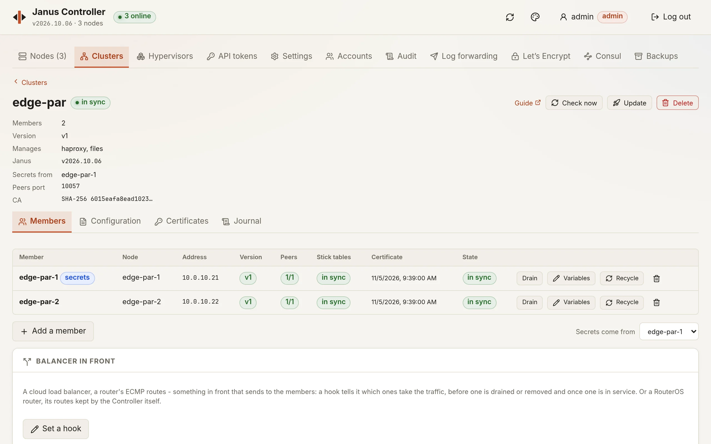

# Clusters

A cluster is a group of nodes the Controller keeps alike: one HAProxy
configuration on every member, their stick tables replicated between
them, their certificates and keys carried from member to member, VRRP
configured from one template, and each member locked against changes
made behind the cluster's back. This page is how to run one through the
Controller - its **Clusters** tab, or its API - or, for a fleet without
a Controller, with `janusctl cluster` ([without a
Controller](#without-a-controller)); how it works is [the cluster
design](../cluster.md).



## What a cluster gives

- **One configuration**, versioned: `haproxy.cfg`, HAProxy's files (maps,
  error pages), and templates for `keepalived.conf`, `bird.conf` and
  `firewall.nft` rendered for each member - its VRRP priority, its
  router ID, its peers' addresses. A version is applied one member at a
  time, checked on the first before any is touched.
- **Stick tables replicated** over HAProxy's `peers` protocol, mutual TLS
  between the members: sessions, counters and rate limits follow a
  client from one member to another, and survive a reload or a failover.
- **Secrets that never leave the nodes for the Controller**: certificates
  and their keys, the Let's Encrypt certificates, the TLS ticket key ring
  go from one member to the others over their own mutual TLS.
- **Locks**: what the cluster manages can only be changed through it. A
  member's own administrator can take a domain back for an emergency -
  the cluster then reports the member as drifted, and never overwrites
  it by itself.

## Before you start

- The nodes trust the Controller's fleet
  ([securing the fleet](../../dashboard/README.md#securing-the-fleet)):
  the cluster acts on its members through it.
- They run the same image - the same extensions, HAProxy branch and
  kernel; `keepalived` in it for VRRP, `bird` for BGP.
- They reach each other on TCP 9505 (the API, which secrets are pulled
  over) and 10057 (HAProxy's peers). A member's firewall must let the
  others in on both.
- Your `haproxy.cfg` names `peers janus` on the stick tables to replicate
  ([your haproxy.cfg](../haproxy-config.md)):

```text
frontend fe
    bind :443 ssl crt /etc/haproxy/files/certs/www.pem tls-ticket-keys /etc/haproxy/cluster/tls-ticket-keys
    stick-table type ip size 100k expire 30m store http_req_rate(10s) peers janus
    http-request track-sc0 src
```

## Creating one

From nodes the Controller has, one of them the **source**: its
configuration becomes the cluster's first version, its certificates and
keys every member's. On the page: **Clusters**, **New cluster** - its
name, then the nodes that join it, each with its member name and the
address the others reach it on, and the source. Through the API:

```sh
curl -X POST https://controller:8080/api/clusters -H "Authorization: Bearer $JANUS_TOKEN" -d '{
  "name": "edge",
  "source": "6f1c2e3a9b7d0451",
  "members": [
    {"node_id": "6f1c2e3a9b7d0451", "name": "lb-1", "address": "192.0.2.11"},
    {"node_id": "a03be1c47d5e9f20", "name": "lb-2", "address": "192.0.2.12"}
  ]
}'
```

- `name`: a label - letters, digits, dashes.
- A member's `name` is HAProxy's peer name; `address` is where the other
  members reach it - left out, the address the Controller reaches it at,
  when that isn't a loopback or a NAT.
- `managed` - what the cluster manages from the start - is
  `["haproxy", "files"]` by default; VRRP, BGP and the firewall come with
  a version carrying their template (below).

The answer is `202`: the cluster is created in the background - checks
(the fleet, the image, HAProxy healthy, each member reaching the others),
a member certificate for each (its key made on the node), the first
version taken from the source, the secrets pulled - first, as the
version may name a file holding a key - and the version applied. `GET
/api/clusters/{id}` follows it: `busy` while it runs, `error` if it
failed, `problems` for whatever wants a look.

### On new machines

Or the Controller makes the members: **New cluster**, **New machines** -
how many, the [hypervisors](../hypervisors.md) they may go to, their
size, release, extensions and network (DHCP), and the **anti-affinity**:

- **required** (the default): each machine on a physical host of its
  own. With fewer hosts than machines, the cluster is refused before
  anything is made, naming the hosts found;
- **preferred**: hosts of their own first, then the least busy - the
  cluster's page says which members share a host;
- **off**: the hypervisors in turn.

Two hypervisor records reaching the same host count as one: the
Controller asks each which host it is (libvirt: the SSH host key it
pinned for the record; Proxmox: the node's name). The machines are named after the cluster -
`edge-1`, `edge-2`... -, the Controller waits until they register and
trust the fleet, then makes the cluster from them, the first one the
source. A failure before that destroys the machines it made.

```sh
curl -X POST https://controller:8080/api/clusters -H "Authorization: Bearer $JANUS_TOKEN" -d '{
  "name": "edge",
  "machines": {
    "count": 3,
    "anti_affinity": "required",
    "hypervisors": ["kvm01-id", "kvm02-id", "pve-c-id"],
    "spec": {"vcpus": 2, "memory_mib": 2048, "version": "v2026.10.24",
             "nics": [{"network": "lab-mgmt", "name": "eth0", "mode": "dhcp"}]}
  }
}'
```

`spec` is a machine's ([hypervisors](../hypervisors.md#the-api)) without
its name and hypervisor, which are the Controller's to give; its
networks must exist on every hypervisor given. The cluster keeps its
placement: a member [recycled](#recycling-a-member) into a new machine
goes where no other member runs - the host of the member it replaces
counts as free, taken last. Each member shows the host it runs on, as
its hypervisor last said: a Proxmox HA migration that brings two
members together shows on the page.

## The configuration

On the page, a cluster's **Configuration** tab: its versions, newest
first, and each one's files; **Edit** makes a new version from the one
shown, **Apply** shows what each file changes from the version the
members run and what the cluster will manage, and asks first.

Through the API, a new version starts from the cluster's current one
(`base`: another), adds or replaces `files` and takes away `delete`:

```sh
curl -X POST https://controller:8080/api/clusters/$CLUSTER/versions -H "Authorization: Bearer $JANUS_TOKEN" -d '{
  "files": {"keepalived.conf": "...", "files/maps/hosts.map": "example.test be_web\n"},
  "note": "VRRP"
}'
```

Its files: `haproxy.cfg`, `files/<name>` (HAProxy's files that hold no
private key - those go through the cluster's certificates, below),
`keepalived.conf`, `bird.conf`, `firewall.nft`. The last three are
templates ([Go's](https://pkg.go.dev/text/template)), rendered for each
member:

| In a template | What it is |
|---|---|
| `{{ .Member.Name }}`, `{{ .Member.Index }}` | The member's name, and its rank from 1 |
| `{{ .Member.Address }}` | Its address |
| `{{ .Member.Vars.priority }}` | One of its variables - set with `PATCH /api/clusters/{id}` `{"vars": {"lb-1": {"priority": "150"}}}` |
| `{{ range .Peers }}{{ .Address }}{{ end }}` | The other members, each with the same fields |
| `{{ .Cluster.ID }}`, `{{ .Cluster.Name }}` | The cluster |

A variable a member lacks is an error, not an empty value. A VRRP
instance for a cluster, each member its priority and its peers:

```text
vrrp_instance front {
    state BACKUP
    interface eth1
    virtual_router_id 51
    priority {{ .Member.Vars.priority }}
    advert_int 0.2
    unicast_src_ip {{ .Member.Address }}
    unicast_peer {
    {{- range .Peers }}
        {{ .Address }}
    {{- end }}
    }
    track_file {
        haproxy weight -100
    }
    virtual_ipaddress {
        192.0.2.100/24
    }
}
```

Then apply it - `managed` when the cluster starts or stops managing a
domain:

```sh
curl -X POST https://controller:8080/api/clusters/$CLUSTER/apply -H "Authorization: Bearer $JANUS_TOKEN" \
  -d '{"version": 2, "managed": ["haproxy", "files", "vrrp"]}'
```

The version is rendered for every member first, checked on the first
member (`haproxy -c`, each daemon's own check), then applied one member
at a time: the files, HAProxy, the files the version no longer has, the
firewall on trial and confirmed, VRRP, BGP - and before the next member,
the member's stick tables learnt back from its peers (a reloaded HAProxy
gets them from a peer after about 5 seconds: members reloaded together
would lose them). The first failure stops it:
the members before run the new version, the others the one they ran,
and the cluster says which. Going back is applying an older version.

## Locks and drift

On a member, a write to what the cluster manages is refused, whoever
makes it, unless the Controller makes it for that cluster:

```text
HAProxy's configuration is managed by cluster edge: change it on the cluster, or release this node's lock first (janusctl cluster release haproxy) - the cluster then reports this node as drifted
```

For an emergency on one node, its administrator releases the domain
(`janusctl -n lb-2 cluster release haproxy`) and changes it. The cluster
sees it at its next look - every 10 minutes, or `POST
/api/clusters/{id}/check` - and reports the member as drifted, its
configuration left as it is. The next apply puts it back and locks it
again. Runtime changes - a server's state, maps and ACLs, stick table
entries, the firewall's sets - are each node's and never locked.

## Certificates and keys

A certificate goes to the cluster, never to a member - on the page, the
cluster's **Certificates** tab; through the API:

```sh
curl -X POST https://controller:8080/api/clusters/$CLUSTER/certificates -H "Authorization: Bearer $JANUS_TOKEN" \
  -d "$(jq -n --rawfile pem www.pem '{name: "www", pem: $pem}')"
```

It is relayed to the member the secrets come from (`secrets_from`, the
source by default) - never kept by the Controller - and the others pull
it from there over their own mutual TLS. `POST /api/clusters/{id}/pull`
has them pull everything again: the uploaded certificates, the files
holding a key, the Let's Encrypt certificates, the TLS ticket key ring.

The ticket key ring rotates every day on that member, and the others
pull it: a client resumes its TLS session on any member - as long as
they serve it the same certificate. When a member leaves, it makes a
ring of its own and the others' is **renewed** - every key replaced -
so it can neither read the tickets the cluster issues nor forge one;
clients make one full handshake. If the member the secrets come from
can't renew it then, the cluster's page says so and the next check
tries again.

## Members

On the page, the cluster's **Members** tab: each member's state, and
for an admin **Drain**, its **Variables**, remove, **Add a member**,
and the member the secrets come from. Through the API:

- `POST /api/clusters/{id}/members` `{"node_id": ..., "name": ..., "address": ...}`:
  checked, given its certificate, the others told, the secrets pulled,
  the cluster's version applied.
- `DELETE /api/clusters/{id}/members/{name}`: drained first - its virtual
  IPs and routes move to the others -, out of the cluster, the others
  told. `?force=true` for a node that doesn't answer any more. The node
  **stays drained** - it may still run the cluster's VRRP or BGP
  configuration - and says so (`janusctl -n NODE cluster get`):
  `janusctl -n NODE cluster undrain` puts it back in service on its own;
  added to a cluster again, it is back in service by itself.
- `POST /api/clusters/{id}/members/{name}/drain` and `/undrain`: out of
  service and back, without leaving.
- A node that is a member can't be removed from the Controller: it
  leaves its cluster first.

## Recycling a member

**Recycle** replaces a member by a new one - a newer release, another
image, a VM on fresh disks - and the traffic moves once:

1. The newcomer joins **drained**: checked, given its certificate, the
   others told, the secrets and the cluster's version applied - its
   VRRP stays BACKUP, its BGP routes unannounced - until its HAProxy
   has learnt the stick tables from a peer.
2. It comes into service as the member is drained: the virtual IP or
   the routes move from the member to it (or a peer), whose tables are
   full; the member's established connections finish.
3. The member leaves. When it was one of the Controller's machines, the
   machine is destroyed.

When the member is one of the Controller's [machines](../hypervisors.md),
the newcomer is a **new machine like it** - same hypervisor, size,
networks (new MACs), extensions - named `<cluster>-<n>`, at the release
you give or the member's. A member with a static address, or a node
that isn't a machine, is recycled into a node you name: one of the
Controller's, trusting the fleet, in no cluster.

A failure while the newcomer joins takes it out again - and destroys
it when the Controller made it -: the cluster is as it was. Its
template variables are the member's. **It may run another image**
lets the newcomer's schematic differ from the members': how a cluster
changes extensions, HAProxy branch or kernel, member by member.

The member left out stays drained until it reboots (`janusctl -n NODE
cluster undrain` to use it again).

## Scaling

A cluster made [on new machines](#on-new-machines) gains and loses
members - the cluster's **Members** tab, **Scaling**:

- **Members**, set by hand (`POST /api/clusters/{id}/scale
  {"members": 3}`): a member more is a new machine like the newest
  member's - its size, networks, extensions and template variables -,
  placed with the cluster's anti-affinity, within the host's free
  memory; a member less is the newest, drained, taken out, its machine
  destroyed. One step at a time.
- **Auto-scaling** (`PUT /api/clusters/{id}/autoscale`): `observe`
  journals what it would do and the count it would have; `on` does it;
  `off`. It reads every member's load every 15 seconds - HAProxy's idle
  time and the CPUs' averaged, the connections' share of `maxconn` the
  highest - and adds a member when, over 5 minutes, HAProxy idles below
  30 %, the CPUs are busier than 75 % or the connections above 70 %; it
  takes one out when one fewer would still stay quiet on every count
  for 30 minutes. 10 minutes between a step out and the next, 30 after
  a step in, 2 steps an hour at most, never below `min_members` (2) nor
  above `max_members`, nor beyond `max_vcpus`/`max_memory_mib` in all;
  no step out while the members' vCPUs wait for their hosts (steal above
  10 %). Thresholds are the policy's (`out_idle_percent`,
  `in_after_seconds`...), checked for hysteresis.
- Members set by hand while auto-scaling is on **pause** it, journaled;
  saving the policy again resumes it.

```sh
curl -X PUT https://controller:8080/api/clusters/$CLUSTER/autoscale -H "Authorization: Bearer $JANUS_TOKEN" \
  -d '{"mode": "observe", "min_members": 2, "max_members": 5, "max_vcpus": 20}'
```

As code: Terraform's [`janus_cluster`](../terraform.md#janus_cluster)
makes such a cluster, its `members` and `autoscaling` changed in place.

Not for a VRRP cluster: one member holds each virtual IP, a member more
adds no capacity - grow its machines instead ([auto-scaling](auto-scaling.md)).
Horizontal scaling suits BGP/ECMP clusters, or a balancer in front that
sends to every member.

## Watching it

The page shows what wants a look at the top of a cluster's page, and
what was done in its **Journal** tab; **Check now** looks at every
member at once. Through the API:

- `GET /api/clusters/{id}`: each member's applied version, drift, released
  domains, peers up, stick tables in sync, certificate expiry, drain -
  and `problems`, worded for you.
- `GET /api/clusters/{id}/journal`: what was done, by whom, member by
  member.
- On a node: `janusctl cluster status` shows its peers as HAProxy sees
  them; its exporter has `janus_cluster_info`, `janus_cluster_peer_up`
  and `janus_cluster_peer_table_synced` ([metrics](../metrics.md)).

## Without a Controller

A [fleet without a Controller](../fleet-without-controller.md) runs its
clusters with `janusctl cluster`, from the fleet's context on an admin's
machine: the same engine as the Controller's - the same checks, the
same order, the secrets moving from member to member - and the cluster
kept in the context's directory, next to its issuing CA: its versions,
what each member runs, its journal, and its own CA, the key `0600` like
`issuing.key`. The nodes are the context's (`janusctl fleet adopt`), the
machine signs as `os:admin`.

```sh
# lb-1's configuration becomes version 1, its keys every member's;
# -address: where the members reach each other, when the context
# reaches them another way (a NAT, a port forward).
janusctl cluster create edge -source lb-1 -dir edge/ \
  -address lb-1=192.0.2.11 -address lb-2=192.0.2.12 lb-1 lb-2

# The configuration is a directory - in git, say: haproxy.cfg, files/,
# keepalived.conf, bird.conf, firewall.nft. Apply makes a version of it.
janusctl cluster vars edge lb-1 priority=150
janusctl cluster vars edge lb-2 priority=100
$EDITOR edge/keepalived.conf
janusctl cluster apply edge edge/ -dry-run
janusctl cluster apply edge edge/ -manage haproxy,files,vrrp -m "VRRP"

janusctl cluster check edge          # each member; exits 1 when one wants a look
janusctl cluster certificate edge www.pem
janusctl cluster add edge lb-3 -address 192.0.2.13
janusctl cluster remove edge lb-3
janusctl cluster replace edge lb-1 lb-4 -address 192.0.2.14
janusctl cluster journal edge
janusctl cluster delete edge
```

| Command | What it does |
|---|---|
| `create NAME NODE... -source NODE` | Checks, member certificates, the source's configuration as version 1 on each, its secrets pulled; `-dir` writes version 1's files to edit |
| `checkout NAME DIR` | A version's files into DIR (`-version N`) |
| `apply NAME DIR` | DIR as the next version, applied member by member; `-dry-run` says what would change, `-manage` what the cluster manages from now on |
| `check NAME` | Each member's version, peers, tables, certificate, drift; renews member certificates and rotates the ticket key ring when due - run it from cron |
| `vars NAME MEMBER KEY=VALUE...` | A member's template variables (`KEY=` unsets one) |
| `certificate NAME FILE` | A certificate and its key for every member (`-crt-list`, `-sni`) |
| `add`, `remove NAME NODE` | A member in, out (drained first; `-force` for a node gone) |
| `replace NAME OLD NEW` | NEW, a node of the context, takes OLD's place: joins drained, learns the tables, comes into service as OLD is drained and leaves (`-var`, `-new-image`) |
| `tickets NAME` | A new TLS ticket key, pulled by the members (`-renew`: every key replaced - what a member's departure does) |
| `list`, `journal NAME`, `delete NAME` | The clusters; what was done; every member leaves |

The members' own primitives work on one node as before: `janusctl -n lb-1
cluster drain`, `cluster status`, `cluster release haproxy`.

The locks are **advisory** here: a write to what the cluster manages is
refused on a member - its page, `haproxy apply-config` - except from an
administrator's certificate that sends the cluster's id, which `janusctl
cluster` does. They keep a member from drifting by accident, not an
administrator out. A drift shows in `check`, and the next `apply` puts
the member back.

Where the cluster lives: one machine's context directory orchestrates
it. Back that directory up with the fleet's; another admin machine
takes the cluster over with a copy of `clusters/<id>/`.

## The API

Readers see clusters, administrators change them.

| Call | What it does |
|---|---|
| `GET`, `POST /api/clusters` | list; create (`{name, source, members: [{node_id, name, address, api_address, vars}], managed, peers_port}`, or `{name, machines: {count, spec, hypervisors, anti_affinity}}`) |
| `GET`, `PATCH`, `DELETE /api/clusters/{id}` | one; change `secrets_from` or members' `vars`; delete (every member leaves; `?force=true`: even those that don't answer) |
| `POST /api/clusters/{id}/members`, `DELETE .../members/{name}` | add one; remove one (`?force=true`) |
| `POST .../members/{name}/drain`, `.../undrain` | out of service, back |
| `POST /api/clusters/{id}/scale` | bring a cluster made on hypervisors to `{members}`, one step at a time |
| `PUT /api/clusters/{id}/autoscale` | its auto-scaling: `{mode, min_members, max_members, max_vcpus, max_memory_mib, ...thresholds}` |
| `POST /api/clusters/{id}/recycle` | replace members one at a time (`{members, with: {member: {node_id, name, address}}, version, new_image}`; a member without `with` gets a new machine like its own) |
| `GET`, `POST /api/clusters/{id}/versions`, `GET .../versions/{n}` | the versions; a new one (`{base, files, delete, note}`); one, with its files |
| `POST /api/clusters/{id}/apply` | apply a version (`{version, managed}`) |
| `POST /api/clusters/{id}/certificates` | a certificate for every member (`{name, pem, crt_list, sni}`) |
| `POST /api/clusters/{id}/pull` | the members pull the secrets again |
| `POST /api/clusters/{id}/check` | look at every member now |
| `GET /api/clusters/{id}/journal` | what was done (`?n=`) |

What takes a while answers `202` and runs in the background, `409` while
another operation runs on the same cluster.
