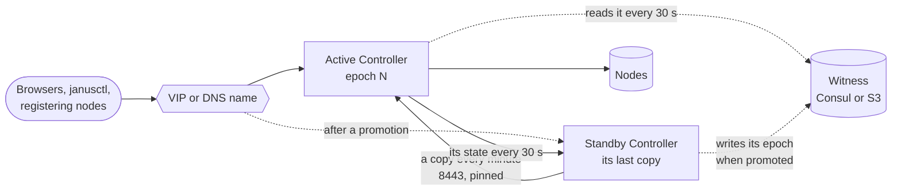

# A warm standby for the Controller

A second Controller that copies the active one every minute and takes
over when you promote it - by hand, never by itself: pairing it, one
address for both, promoting it or switching over, and what a promotion
leaves behind.

## How it works

- **Two Controllers, one active.** The active runs as always - its
  page, its loops, its nodes. The standby runs nothing: it copies the
  active every minute, answers the active's questions, and shows a page
  saying what it is. Nodes, browsers and janusctl only ever deal with
  the active.
- **A copy** is the active's data directory and its master key - what a
  [backup](../../dashboard/README.md#backups) holds, without the nodes'
  configurations (the nodes keep them). It travels over TLS 1.3 between
  the two registration ports (8443), each Controller pinning the other's
  certificate and sending the secret they share since their pairing; the
  standby keeps the last one sealed with its own master key.
- **Promoting** the standby restores its last copy - or a final one the
  active hands over - and starts it as the active, one **epoch** above.
  It's the same Controller: its identity, accounts, fleet and nodes. The
  nodes keep trusting it; nothing is done to them.
- **The epoch fences** the old active: a Controller that finds its peer
  active at a higher epoch than its own becomes its standby.
- **The witness** - a record in Consul or in the backups' S3 bucket,
  which both reach even when they can't reach each other - says which of
  the two holds the epoch: an old active cut off from its standby learns
  there that it was replaced.



## Pairing a standby

1. On the active: **Settings › High availability › Add a standby**. The
   pairing token is shown once, good for an hour, with the command to
   run.
2. On the standby's host - the same Compose file, a **new** data
   volume:

   ```sh
   docker compose run --rm janus-controller \
     standby -peer 192.0.2.11:8443 -pair janus-standby_... -address 192.0.2.12:8443
   docker compose up -d
   ```

   It pairs, takes a first copy and exits; started, the Controller runs
   as the standby.

- **`-peer`** is the active's registration port at **its own address** -
  not the VIP or the name both share, which follow the active and would
  lead the standby to itself after a promotion. The token pins the
  active's certificate: a token another Controller made is refused.
- **`-address`** is the standby's registration port as the active
  reaches it (default: its first `-advertise-address`, or its first
  address, port 8443); **`-name`** what the active calls it (its host
  name).
- Each reaches the other's 8443: open it between the two hosts.
- The standby's master key file must be writable
  (`JANUS_CONTROLLER_MASTER_KEY_FILE` in a volume, as in the
  [Compose file](../../dashboard/README.md#the-compose-setup)): a
  promotion puts the active's there.
- Update the standby first: it keeps no copy from a newer release than
  its own, and says so on its page.
- **Updating from v2026.11.02 or v2026.11.02-2**: a standby listens on
  `<data>/ha/control.sock`, which these releases leave behind when it
  becomes the active, and their updater refuses to back a socket up - the
  update of a standby, or of an active that has once been one, stops
  there, nothing changed. On such an active, delete `ha/control.sock`
  from the data volume first (nothing listens on it); a standby, update
  by hand: `JANUS_CONTROLLER_IMAGE` in `.env`, then `docker compose up
  -d`, which recreates the updater too. Later releases remove a stale
  socket when the Controller starts, and their updater leaves sockets
  out.

The active's card then shows the standby, its last copy and how it
answered the last time it was asked. **Remove the standby** forgets it:
stop it on its host too.

## One address for both

Nodes register at an address, browsers and janusctl reach one: give
both Controllers the same - a VIP keepalived moves, or a DNS name you
point at the active - first in `-advertise-address`
(`JANUS_CONTROLLER_ADVERTISE_ADDRESS`), so the identity certificate
covers it on both. Each Controller then renews it for its own
addresses.

With keepalived on both hosts, the VIP follows the active - it never
promotes anything:

```text
vrrp_script janus_controller_active {
    script "/usr/bin/curl -fsk -m 2 https://127.0.0.1:8080/api/ha/active"
    interval 5
    fall 2
    rise 2
}

vrrp_instance janus_controller {
    state BACKUP
    interface eth0
    virtual_router_id 61
    priority 100
    advert_int 1
    virtual_ipaddress {
        192.0.2.10/24
    }
    track_script {
        janus_controller_active
    }
}
```

`GET /api/ha/active` answers 200 on the active only, 503 on the standby
and on an active stepping down - no sign-in needed.

## Promoting it

On the standby's host:

```sh
docker compose exec janus-controller /dashboardd promote
```

- **The active answers**: it hands the standby a last copy, becomes its
  standby and starts again as one - nothing it did is lost. The
  active's page does the same: **Switch over** on its High availability
  card.
- **The active is gone**: the standby promotes itself on its last copy -
  at most a minute old. While the active answered less than 2 minutes
  ago without handing over, it refuses: the active may still run. Stop
  it, then `promote -force`. With a [witness](#the-witness), the standby
  writes its new epoch there first; when it can't, it refuses too -
  the old active couldn't learn it's replaced - unless forced.

The new active starts within seconds - everyone signs in again; its
first start logs what to check when it runs on another host, as after a
restore ([when the Controller is down or lost](recovery.md#restore-it)).
To switch back, once the old active runs as its standby: **Switch over**
from the new active's page.

With the standby stopped, `docker compose run --rm janus-controller
promote` promotes its data directory itself, for the next start.

## Epochs: the old active steps down

Each promotion is one epoch above anything either Controller saw. A
Controller that finds its peer active at a higher epoch steps down -
when it starts, before any of its loops, and every 30 s while it runs -
and becomes its standby. What it held is set aside in
`<data>/ha/previous/<time>/`: what it did after its last copy, kept for
you to look at, never merged - the two newest only, each a whole data
directory. It then copies the new active.

```sh
docker compose exec janus-controller /dashboardd ha status
# role:   standby
# epoch:  1
# peer:   ctl-a (192.0.2.11:8443), paired 2026-11-01T18:20:41Z
# copy:   42s ago - version v2026.11.01, epoch 1, 48213 bytes
# active: answered 42s ago
```

## The witness

Without one, an active cut off from its standby - a network partition,
not a crash - can't learn that the standby was promoted: two actives run
until one sees the other. The witness is a record both reach on their
own path, signed by the HA key of the Controller holding the epoch:

- **Where**: in **Consul's KV**, key `janus/controllers/<id>/witness`,
  when [Settings › Consul](consul-controller.md) is on - the Controller's
  token needs `key_prefix "janus/controllers/" { policy = "write" }`
  ([its policy](consul-controller.md#before-you-start)); otherwise in
  the **backups' S3 bucket**, object `<prefix>janus-controller-<id>.witness.json`,
  when [backups](../../dashboard/README.md#backups) have a bucket set up
  (scheduled or not). The settings choose, never which one answers: two
  witnesses would be two truths. Neither set up: no witness.
- **Promoting** writes the new epoch there first. A Consul write is a
  check-and-set; an S3 one names the ETag it read (`If-Match`,
  `If-None-Match` when there's none) - AWS, MinIO, versitygw honour
  them; a service that refuses them gets a plain write, and the card
  says so.
- **The active** reads it every 30 s and when it starts with its peer
  silent: when its peer holds an epoch above its own, it steps down and
  becomes its standby - within 30 s of a promotion, as long as it reaches
  the witness. A record neither of the pair signed is written over.
- **The High availability card** shows where it is, which epoch it holds
  and whose, or why it can't be read.

An active that reaches neither its standby nor the witness keeps
running: the witness never stops a Controller by being away - a Consul
or S3 outage would be a Controller outage.

## What a copy holds

| Copied | Not copied |
|---|---|
| Accounts, second factors, API and enrollment tokens | Sessions: everyone signs in again |
| Nodes, labels, the fleet and its issuing CA, the identity | The nodes' configurations: the nodes keep them |
| Hypervisors, machines, clusters, the audit | `<data>/ha`: each Controller's own pairing |
| The master key | Images on their way to a hypervisor |

## Limits

- **Up to a minute lost** when the active didn't hand over: a machine a
  hypervisor created since the last copy is an orphan - delete it on
  the hypervisor; a cluster change under way is lost - its reconcile
  reports the drift.
- **Two actives for a moment**: `promote -force` with the old active
  still running behind a partition leaves two actives - for up to 30 s
  when it reaches the [witness](#the-witness); until one sees the
  other's epoch without one, or when the old active reaches neither its
  standby nor the witness. Stop the old host before forcing.
- **One standby**, promoted by hand - a failover nobody decided can't
  split the fleet.
