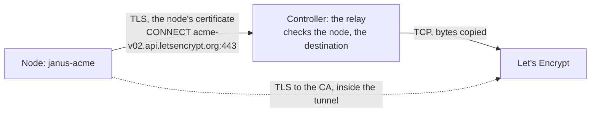

# The Controller and Let's Encrypt

A node that reaches its Controller but not the internet can still get
its Let's Encrypt certificates: through the Controller's relay. This
page is the Controller's side - turning the relay on, what it lets
through, what it records. The node's side, and the other ways to reach
the CA, are in [Let's Encrypt](../letsencrypt.md#how-the-node-reaches-lets-encrypt).

## What the relay is

An HTTPS proxy on the Controller that only tunnels (`CONNECT`):

- **The node still does everything itself** - its account key, its
  orders, its DNS provider's secrets stay on the node. The relay holds
  none of them.
- **Encrypted end to end**: the node's TLS to the CA runs inside the
  tunnel, checked against the CA's own certificate. The relay sees which
  host a node reaches, when, and how many bytes - never what it says.
- **Only the Controller's nodes**: the node presents a certificate of
  its own CA, made for each request; the relay checks it against the CA
  the Controller pins for each node it was added with. A node removed
  from the Controller is refused at once.
- **Only where certificates come from**: Let's Encrypt's API hosts and
  the DNS providers' API hosts, on port 443 - plus what an admin allows
  besides (a private ACME CA, the API an `httpreq` or `pdns` provider
  names).



## Turning it on

The relay is off until an admin turns it on: the Controller's **Let's
Encrypt** tab, **Relay for the nodes**.

- **Listens on**: `:8444` by default. A Controller in a container needs
  the port reachable from the nodes - with `--network host` (the
  recommended setup, [Controller](../../dashboard/README.md)) there's
  nothing to map.
- **The nodes reach it at**: the address the nodes are given, a name or
  address in the Controller's identity - the certificate nodes register
  against. Left empty, the Controller takes the host it suggests for
  registration, with the relay's port. A name the identity doesn't hold
  makes the node's check fail ("certificate is valid for ..."): the
  identity's names come from `-advertise-address` when it was first
  made.
- **Destinations allowed besides the built-in ones**: `host:port`, one
  a line. The built-in ones are listed under the form.

Saving applies at once: the relay listens, or says why it can't (a port
already taken) and nothing changes. The settings are kept in
`<data>/acme-relay.json`, part of the Controller's backups.

Then, on each node's page - **Apps › Let's Encrypt** - **Through this
Controller**: the relay's address and the Controller's identity come
with the choice; **Test** fetches the CA's directory through the relay.
With janusctl, the tab shows the command and offers the identity's
file:

```sh
janusctl haproxy acme path controller https://controller.example.net:8444 -ca controller-identity.pem
```

## What goes through, and what can't

| | Through the relay? |
|---|---|
| The ACME API (Let's Encrypt, its staging) | yes, built in |
| A private ACME CA | once an admin allows its `host:port` |
| DNS-01: `cloudflare`, `desec`, `digitalocean`, `gandiv5`, `hetzner`, `infomaniak`, `ionos`, `ovh`, `scaleway` | yes, built in |
| DNS-01: `httpreq`, `pdns` | once an admin allows the host their settings name |
| DNS-01: `route53` | no - the AWS SDK makes its own connections, without the node's certificate |
| DNS-01: `rfc2136` | no - it updates the zone's name server over DNS |
| DNS-01's lookups (the zone, the record appearing) | no - from the node to its resolvers |
| HTTP-01 | the CA reaches the node on port 80 itself - not the relay's business |

## What it records

Each tunnel - the node, the destination, the bytes each way, how long
it lasted - and each refusal, with why, go to the Controller's log
(`acme relay: ...`, sent wherever the Controller's log is
[forwarded](log-forwarding.md)) and to the **Recent tunnels** list on
the tab (the last 100, kept in memory). A client certificate the relay
doesn't know never gets as far as a tunnel: the TLS handshake fails, and
the log says so.

## Limits

- 8 tunnels open at once per node, 256 in all; 60 opened at once per
  node, then one a second.
- A tunnel idle for 2 minutes is closed; none lasts more than 15
  minutes (what janus-acme gives an order).
- TLS 1.3 only.

## When the Controller is down

Nothing is obtained or renewed through it meanwhile: the node retries,
its certificates go on being served. A Let's Encrypt certificate lasts
90 days and is renewed from day 60 - a Controller down for a few days
changes nothing.
