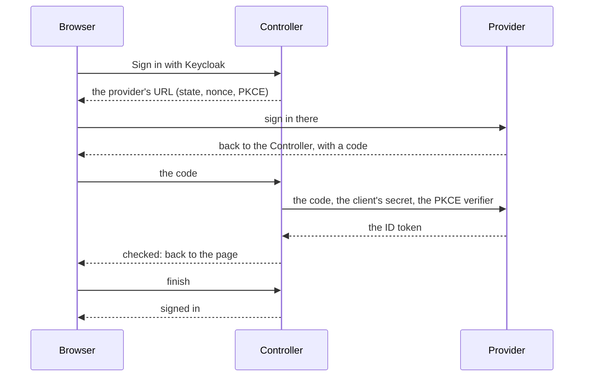
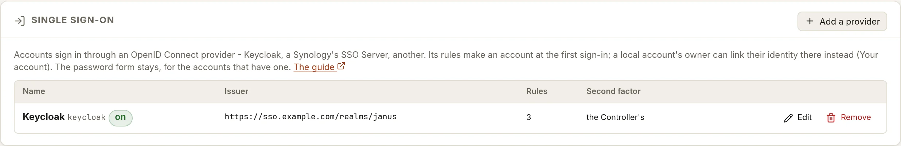

# Single sign-on

Accounts sign in to the Controller through an OpenID Connect provider -
Keycloak, a Synology's SSO Server, any other - instead of a password: the
provider's groups decide what each person may do, and signing out of the
Controller signs out of the provider too, where it says how.

Nothing changes for the accounts that have a password: the password form
stays on the sign-in page, under the providers' buttons - it's also the
way in when a provider isn't there.

## How it works

The page sends the browser to the provider; the provider sends it back
with a code, which the Controller exchanges for an ID token - the
authorization code flow, with PKCE (S256), a state and a nonce. The
Controller checks the token itself (`dashboard/backend/internal/sso`):
issued by the provider exactly as configured, for this Controller, not
expired, signed by one of the provider's keys with an asymmetric
algorithm. Then:

- an identity already **bound** to an account signs that account in;
- otherwise the provider's **rules** turn its groups into a role, and an
  account is made, named after it - at its first sign-in;
- nobody a rule doesn't match gets in.



An identity is bound by its issuer and its subject - what the provider
calls it for good - never by a name or an e-mail address, which someone
could change at the provider to take another person's account.

Once signed in, your account's dialog - your name, at the top right -
says how: *This session: signed in through Synology*, or *with your
password*; so does the button's tooltip, and the audit records the
sign-in `via sso <id>`.

## Adding a provider

**Accounts** tab › **Single sign-on** › **Add a provider** opens the
provider's form. Open the Controller by the name your users will use
first: the provider sends the browser back to exactly that address, and
the form shows the addresses to register there for the Controller as
you opened it.



| Field | What it is | For example |
|---|---|---|
| **Kind** | Keycloak, a Synology SSO Server or another provider: fills in the scopes and the claims below for that kind of server | Synology SSO Server |
| **ID** | A short name of your choosing for this provider, **on the Controller only**: never sent to the provider, nothing to do with its client ID. It names the provider in the Controller's URLs (`/api/auth/sso/<id>/start`), in every account the provider makes (their badge on the **Accounts** tab), in the log and the audit (`sso: <id>: …`, `via sso <id>`). Set once - changing it means removing the provider and adding it again, and the accounts it made lapse. 1 to 32 lowercase letters, digits and `-` | `synology`, `keycloak` |
| **Name** | The sign-in button's: "Sign in with *Name*" | Synology |
| **Redirect URI**, **Post-logout URI** | Shown by the Controller, to copy into the provider's settings: `https://<controller>/api/auth/sso/callback` and `https://<controller>/` - the same for every provider | |
| **Issuer URL** | The provider's issuer, exactly as its discovery document says it | `https://nas.example.com/webman/sso` |
| **Client ID**, **Client secret** | The client (application) registered at the provider. The secret is sealed with the Controller's master key and never shown again; none makes a public client, bound by PKCE alone | DSM's **Application ID** and **Application secret** |
| **Scopes**, **Username claim**, **Groups claim** | Filled in by the kind: what to ask the provider for, the claim that names the account, the one that lists its groups | `openid email groups`, `username`, `groups` |
| **Its certificate is trusted by** | How the Controller trusts the provider's certificate ([below](#its-certificate)) | the system's trust store |
| **Rules**, **Anyone it signs in gets at least** | Who gets what ([below](#rules-who-gets-what)) | `janus-admins` gives admin; none for the others |
| **Its accounts stop working after** | How long an account it made works without signing in through it again ([below](#accounts-a-provider-makes)) | 7 days |
| **The second factor** | The Controller's own, or the provider's ([below](#the-second-factor)) | the Controller's |
| **For a provider that needs it** | No PKCE, an ID token without the nonce accepted, signing out of the Controller only - only for a provider whose sign-in fails without them | |
| **Offer it on the sign-in page** | The button on the sign-in page | ticked |

Then **Test**: the Controller fetches the provider's discovery document
and keys the way a sign-in will, and says what won't work - an issuer
that isn't exactly the one the provider gives itself (copy the one it
shows), a scope or a claim the provider doesn't list, no PKCE, no way to
sign out at the provider. Save: the button is there.

### Keycloak

In the realm (Keycloak 26):

1. **Clients** › **Create client**: OpenID Connect, a client ID
   (`janus`); **Client authentication** on, **Standard flow** only.
2. **Valid redirect URIs**: the redirect URI above, exactly - no
   wildcard. **Valid post logout redirect URIs**: the post-logout URI.
3. **PKCE Method** (in **Capability config**; **Advanced** › **Proof Key
   for Code Exchange Code Challenge Method** in older versions): `S256`.
4. **Credentials**: copy the client secret.
5. **Client scopes** › the client's dedicated scope › **Add mapper** ›
   **By configuration** › **Group Membership**: token claim name
   `groups`, **Add to ID token** on. With **Full group path** on (the
   default), groups read `/janus-admins`, `/ops/janus-admins`: write the
   rules so.

The issuer is `https://<keycloak>/realms/<realm>`. Realm roles instead
of groups: a **User Realm Role** mapper with the claim name `roles`, in
the ID token, and `roles` as the groups claim.

### Synology SSO Server

On the NAS (SSO Server 3, DSM 7.2):

1. **General Settings**: a **Server URL** by name, with a certificate -
   DSM refuses an IP address there and in redirect URIs; tick **Enable
   OIDC server**. The issuer is `https://<nas>/webman/sso`: copy the
   well-known URL it shows without `/.well-known/openid-configuration`.
2. **Application** › **Add** › OIDC: a name and the redirect URI above;
   copy its **Application ID** (the client ID) and **Application
   secret**.
3. On the Controller, the **Synology SSO Server** kind, an ID of your
   choosing (`synology`), the issuer, the Application ID and secret: the
   kind fills in scopes `openid email groups` (the SSO Server has no
   `profile`), the name from the `username` claim, the groups from
   `groups`.

What to know about the SSO Server:

- its subject is the DSM user's name: a user renamed on the NAS is a
  new person to the Controller, and a user deleted then made again with
  the same name gets the old account back;
- groups are the DSM groups' names (`administrators`, `users`) - for a
  domain's users, `DOMAIN\group`: write the rules with exactly what the
  Controller's log shows (below);
- it says nothing about its own second factor, and has no sign-out
  endpoint: signing out of the Controller leaves the NAS's session open;
- if a sign-in fails at the code exchange, try **No PKCE**; if the
  Controller says the ID token has no nonce, **Accept an ID token
  without the nonce** (never both: the Controller refuses that).

### Another provider

Authentik, Authelia, Zitadel, Dex, Entra ID...: a confidential client
with the redirect URI above, the scopes it needs for a name and the
groups (often `openid profile email` and `groups`), the claim naming the
user (`preferred_username` by default) and the one listing the groups.
A dotted name reaches into an object: `realm_access.roles`.

### Its certificate

The Controller fetches the provider's keys and exchanges codes itself,
trusting the provider's certificate the way the provider's settings say:
the system's trust store (a public certificate), a CA certificate (PEM:
an internal CA, the one a Synology exports), or a SHA-256 fingerprint -
the provider's own certificate's, or a CA's in the chain it presents.
Over HTTPS only, no proxy, no redirect followed.

## Rules: who gets what

A rule gives the people in a group a role:

| Group | Role | On the nodes labelled | Only |
|---|---|---|---|
| `/janus-admins` | admin | | |
| `/janus-ops` | operator | | |
| `/web-team` | operator | `team=web` | HAProxy |

A rule without labels or domains gives the role over everything; with
them, a grant on those nodes - as an admin gives on the
[Accounts tab](../../dashboard/README.md#accounts-and-roles). Someone in
several groups gets the **highest** role their rules give, and every
grant. **Anyone it signs in gets at least** a role, if you like: then
nobody is refused. Otherwise someone no rule matches is refused - and an
account the provider made loses its role and grants.

The rules apply at every sign-in, and again as soon as they change, to
the groups each account had at its last sign-in: a role taken away ends
the account's sessions at once. A group changed at the provider counts
at the next sign-in.

## Accounts a provider makes

At its first sign-in, the account is named after the username claim,
lowercased - refused if another account has that name (a local account
is never taken over: its owner links the identity instead, below), or
if it isn't a name an account may have. It has no password; the
**Accounts** tab shows its provider, and its role and grants as the
rules give them - change the rules, not the account.

**It lapses** a week after its last sign-in through the provider
(**Its accounts stop working after**, 0 to never): its sessions, API
tokens and SSH keys stop working until it signs in through the provider
again - someone removed at the provider loses everything the Controller
gave them, even without signing in again. Disable the account to keep
someone out at once; deleted, it's made again at the next sign-in if a
rule still lets it in. Removing the provider makes its accounts lapse.

`dashboardd reset-user NAME` turns such an account into an ordinary one,
with a password to choose and its role kept - its identity stays linked.

## Linking an account that has a password

An account with a password can sign in through a provider too. Signed
in with the password, open your account's dialog - **your name**, at
the top right of the page - and, under **Single sign-on**, **Link
Keycloak** (the provider's name): your password again, then the provider
asks you to sign in there - whoever was signed in there already isn't
linked silently. The identity then signs you in as you, with your role
(the rules don't change it, but one must still let the identity in).
The same dialog forgets it; an admin can too (**Unlink** on the
Accounts tab).

**Your provider's name is your account's?** Signing in through the
provider is refused - "An account of this name already exists" -, and
that page offers **Sign in with its password to link it**: sign in with
the account's password, and its dialog opens on the link above.

Linking needs a sign-in that gave your second factor, if your account
has one, like adding an SSH key: a sign-in a trusted browser let in
without it gives it once more, in the dialog, first.

## The second factor

**The Controller asks for its own** (the default): signing in through
the provider stands for the password only; the Controller's second
factor - an authenticator app, a passkey - and its policy apply as for
a password, trusted browsers included.

**The provider's counts**: the provider's sign-in stands for both, and
the Controller asks for nothing more - whatever its policy. To trust it
only when it says it did, give the values its ID token must carry: an
`acr` or an `amr`. When the token doesn't carry one, the Controller asks
for its own. A Synology says nothing: trust it as is, or keep the
Controller's.

With Keycloak:

- **`acr`**: the level of authentication. Out of the box, `1` is a
  sign-in where the password was typed, `0` one Keycloak's own session
  skipped - neither says a second factor was given. Give its browser
  flow levels (*Conditional - Level Of Authentication*: level 2 = the
  password and an OTP), map them to names in the realm's or the client's
  *ACR to LoA mapping* (`gold` = 2), and ask the Controller for `gold`:
  it sends `acr_values=gold`, Keycloak runs the steps that level needs,
  and the Controller checks the token says so.
- **`amr`**: how the person signed in - add the *Authentication Method
  Reference (AMR)* mapper to the client, give the OTP step its reference
  (`otp`), and ask the Controller for `otp`.

An account a provider made, without a password, confirms a change to its
second factors with a code of its authenticator app, a recovery code,
or a passkey.

## Signing out

Signing out of the Controller ends its session, then sends the browser
to the provider's sign-out (its `end_session_endpoint`, with the ID
token as a hint) and back to the Controller's sign-in page - so the next
person at that browser doesn't get in through the provider's session.
A provider without one (a Synology), or **Signing out ends the
Controller's session only**: the provider's session stays open.

Disabling a provider ends the sessions that came through it.

## janusctl

`janusctl login` through the browser (the default, or `-device`) works
for any account: sign in on the page that opens, through the provider.
The certificate it gets lasts 12 hours, an account's API tokens and SSH
keys as long as the account doesn't lapse.

## When signing in fails

The page says what went wrong, with a **reference**; the Controller's
log says more under it - `docker logs janus-controller`:

```text
sso: ref 1c14706c: kc: access: sub "514fb839-886e-4f09-80ba-28067d2cc951", 0 groups: the provider's rules give you no access to this Controller
```

| Shown | What happened |
|---|---|
| isn't set up right | the provider is disabled or gone, its secret doesn't open, the redirect URI isn't the one the browser came back to, or the issuer isn't the one the provider gives itself - **Test** says which |
| didn't answer as it should | the provider was unreachable, or refused the code exchange (its error, quoted in the log: a wrong secret is `invalid_client`) |
| didn't sign you in | the person cancelled, or the provider refused |
| didn't check out | the ID token: another issuer, audience or nonce, expired (is the Controller's clock right?), a key it doesn't publish |
| is over | the sign-in took more than ten minutes, was used already, or another one started in the same browser since |
| no access | no rule matches the person's groups |
| already exists | the name is an account's of the Controller: sign in with its password and link the identity - the button on that page ([above](#linking-an-account-that-has-a-password)) |

The first sign-in after each change of a provider's settings logs the
names of the claims its ID token carried - never their values: what to
look at when the groups don't come.

```text
sso: kc: the ID token's claims: acr at_hash aud auth_time azp email email_verified exp family_name given_name groups iat iss jti name nonce preferred_username sid sub typ (1 groups)
```

## Rolling back the Controller

A Controller older than single sign-on drops what it doesn't know when
it saves the accounts: the identities, and which provider made an
account. The accounts a provider made then have no password and no
identity - `dashboardd reset-user NAME` gives one a password -, and a
provider's next sign-in finds its name taken.
