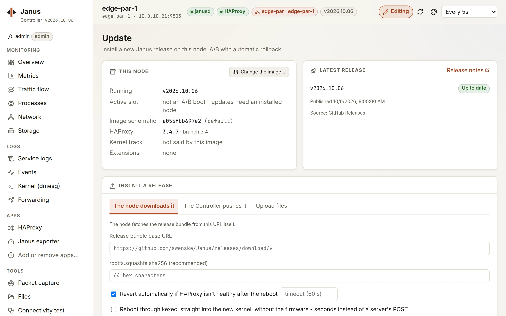

# Updating nodes

A node updates as a whole: the next release's system is written to its
idle slot, checked, and booted - its configuration kept - and the node
goes back to the previous release by itself if HAProxy doesn't come back
healthy. How it works: [lifecycle](../private-cloud/lifecycle.md).

## When there's an update

The Controller checks for new releases and shows, on each node's card,
whether an update is available - with a 🔒 when it fixes a
vulnerability on that node (an extension's fix only for the nodes that
have it). The latest release is supported, and the previous one for 14
days after the next one ships - the time to try the new release first;
a vulnerability fixed in those days gets a
[maintenance release](#maintenance-releases) of it. Install security
updates promptly ([security policy](../../SECURITY.md)).

## From the Controller

On the node's page, **System › Update**:



1. It shows the node's release, slot and extensions - and what its
   other slot holds: the release an update writes over, the one a
   rollback boots -, and the release to install - from its GitHub
   release, or built by the image factory for the node's extensions.
2. **Install a release**, in one of three ways:
   - **the node downloads it** - from GitHub or the image factory;
   - **the Controller pushes it** - for a node that can't reach the
     internet: the Controller downloads the bundle and streams it to the
     node;
   - **upload files** - a bundle from your computer, through the
     Controller.
3. Keep **automatic revert** on: the node confirms itself only once
   HAProxy answers healthily after the reboot, and goes back otherwise.
4. **Reboot through kexec**, if you like: the node jumps straight into
   the new kernel, without the firmware - seconds where a server's POST
   takes a minute (what to know first: `-kexec` under [With
   janusctl](#with-janusctl)).
5. **Install and reboot**: the confirmation names the release it
   installs - and says so when it is older than the node's, which then
   takes its version typed. The page follows the node through its reboot
   until it's back, on its new slot, and says whether it went through
   kexec or, when it couldn't, the firmware.

Update the nodes of a pair one at a time: before rebooting, a node gives
its virtual IP or its BGP route up, so the other one serves alone for
the minute it takes. The members of a [cluster](clusters.md) are
[updated in place](clusters.md#updating-a-cluster) by the cluster
itself, in one action: each drained, updated, its stick tables learnt
back, then the next.

**Changing the image** - its extensions, its HAProxy branch, its kernel
track - is an update too: **Change the image…** on the same page asks
the image factory for the newest release built with what you pick (a
node running a [pre-release](#pre-releases) stays on it), and
the installation confirms what the node gains and loses ([images and
extensions](../image-factory.md#updates-keep-the-schematic)). Another
HAProxy branch may refuse the node's configuration: check it against
that branch first ([what differs](../haproxy-config.md#haproxy-branches));
the automatic revert stays on for such an update. A node pinned to a
HAProxy branch shows when its upstream support ends, and when the
releases stopped offering it (no newer update will come).

## With janusctl

```sh
v=v2026.10.05-5
janusctl -n lb1 lifecycle upgrade -wait-for-health \
  https://github.com/swenske/Janus/releases/download/$v/
janusctl -n lb1 version           # the release now running, and its slot
```

- `-wait-for-health` is the automatic revert; `-health-timeout` how long
  HAProxy has to be healthy.
- A node with extensions takes its schematic's bundle - the URL the
  [image factory](../image-factory.md#getting-an-image-janussw-serversnet)
  gives for it - and refuses another schematic's unless
  `-allow-schematic-change`.
- A server that fails to answer - no answer, a timeout, 408, 429 or a
  5xx gateway error, as GitHub's downloads did for hours some days - is
  asked again 5, 15, 30 and 60 seconds later (its `Retry-After`, up to
  a minute, if it gives one), each new try shown as the update goes
  (`… 504 Gateway Timeout - trying again in 5s (2/5)`); a 404 is final.
- A node that can't reach the URL: `janusctl lifecycle upload-release
  DIR` streams a bundle from where `janusctl` runs, then `upgrade` takes
  the directory it prints. The root filesystem goes straight into the
  node's other slot, which no longer holds its previous release until
  the update completes.
- A bundle whose `rootfs.squashfs` or `rootfs.verity` isn't the one its
  kernel image was built with - damaged on its way, or files of two
  builds in one directory - is refused, each block checked before it's
  written (`rootfs.squashfs: … nothing was written`): take the four
  files of one release again. Refused once part of it was written, the
  node keeps running, but its other slot holds neither release: update
  it again with a sound bundle - `lifecycle rollback` refuses that slot.
- A release whose kernel has no driver for the node's boot disk or for
  one of its network interfaces is refused (`this release's kernel
  (virt) has no driver for nvme (boot disk nvme0n1)`): a kernel that
  can't see its disk waits for it forever, before anything on the node
  could roll it back. Each image's `image.json` names what its kernel
  drives; the node compares it with the drivers its boot disk and
  network interfaces are bound to now - janusd logs them at every boot
  (`hardware: boot disk vda: virtio_blk, virtio-pci; eth0: virtio_net,
  virtio-pci`). `-allow-unsupported-hardware` installs it all the same,
  only for a machine whose devices change before it boots the release
  (`lifecycle install` checks the target disk the same way). The other
  slot then holds the refused release: update again rather than roll
  back.
- `-kexec` reboots into the new release without going through the
  firmware: the running kernel jumps straight into the new one, in
  seconds, where a server's POST takes a minute. The same flag on
  `janusctl system reboot`; on the Controller, **Reboot through kexec**
  on the node's Update page and **Through kexec** on its **System ›
  Power** page; for a node Terraform manages, `update_reboot_mode`
  ([Terraform](../terraform.md#janus_node)). It is opt-in: a driver left
  in an odd state by the running kernel is kexec's known risk, which a
  firmware reboot never has - try it on a node you can reach otherwise,
  then make it your habit where it works. With Secure Boot on, only a release signed
  by Janus can be kexec'd, as the firmware would only boot that; an
  update that can't be kexec'd reboots through the firmware and says so.
  A revert always goes through the firmware. Proven on Proxmox VE 9.2
  (the API answers 3.4 s after the call, 7.3 s through the firmware)
  and on the Controller's own libvirt machines. Known not to work: a
  libvirt machine with Secure Boot enabled (`<loader secure='yes'>`:
  QEMU locks the firmware flash to SMM) on a host whose OVMF is
  2025.02 (Debian 13's `ovmf` package): the kernel jumped into crashes
  at once and the firmware boots the node instead - slower, not lost.
  A newer edk2 (2026.08, what Proxmox VE 9.2 ships) is fine with the
  same machine. Bare metal is untried.
- A firmware reboot of a virtual machine takes **30 to 40 s longer about
  once every 40 boots**. The UEFI firmware (OVMF: Debian 13's 2025.02 and
  Proxmox VE 9.2's 2026.08 alike) rewrites its console variables at every
  boot - about 6 KB of its 256 KiB variable store - and compacts the store
  once it is full, through QEMU's emulated flash, byte by byte: 30 s on an
  idle host. The node takes no part in it (its kernel is down in 0.2 s). A
  kexec reboot never goes through the firmware. A libvirt machine made by
  hand can run without a variable store, which Janus never uses: the
  firmware's code alone, `<loader readonly='yes' type='pflash'
  stateless='yes'>/usr/share/OVMF/OVMF_CODE_4M.fd</loader>` and no
  `<nvram>` (libvirt 8.6 or later; firmware auto-selection can't choose it
  on Debian 13). The Controller's libvirt machines run that way: it lets
  libvirt choose their firmware, then keeps its plain code alone before
  their first start. One made before keeps its store until it is
  recycled - so does one made by the Controllers of v2026.10.25-3 and -4
  on a host prepared as [hypervisors](../hypervisors.md) says: they asked
  the host for its firmware images, which that preparation doesn't let
  them read. A Proxmox VE
  machine keeps its EFI disk.

## Pre-releases

A pre-release is a release published to be tested first - on a lab's
nodes, by beta testers - before it becomes the release. Once it has
been, the same build is promoted, unchanged: a node running it then
simply runs that release, with nothing to reinstall. One that fails its
tests is never promoted, and the next release replaces it.

- **It is never an update.** No badge, no "update available", nothing
  counted in the fleet: the Controller shows it on a node's **System ›
  Update** page only, folded under the latest release (**Pre-release vX
  available, for testing**), and an admin sees it on the Controller's
  update card. **Use this pre-release…** asks for its version, typed,
  then fills the usual A/B installation in; for a node with extensions
  the image factory builds it first, and the page follows the build.
- **Changing its image keeps it on the pre-releases.** On a node running
  one, **Change the image…** lists what that pre-release offers - or the
  newest pre-release, when a newer one is out - and prepares it with what
  you pick: adding or removing an extension doesn't take the node back
  to the release. A node running a release changes its image on the
  newest release, as always.
- **It isn't supported** ([security policy](../../SECURITY.md)): install
  it where you test, not where your production depends on it. To leave
  it, **Rollback** goes back to the release the node ran before; the
  next release is offered as an update as usual.
- Nodes running one are marked **pre-release** - on the fleet, on the
  node's page, in `janusctl tui`.
- The Controller reads GitHub's list of releases every ten minutes at
  most: one just published shows within ten minutes - at once with the
  **Refresh** button, in the Controller's header or a node page's top
  bar.
- **By version**, like any release: `janusctl lifecycle upgrade` with
  its download URL (above), a Terraform `janus_node`'s `version`, the
  Controller's create-a-node form (which suggests it), the image
  factory's builder (which lists it, marked).
- `janusctl`'s pre-release packages are in apt's `testing` suite
  ([installing janusctl](../janusctl.md#installing-janusctl)).

Pre-releases are on the [releases page](https://github.com/swenske/Janus/releases),
marked; GitHub's **Watch → Custom → Releases** notifies them too.

## Maintenance releases

While the previous release is supported - 14 days after the next one
ships - a vulnerability fixed in the latest release is fixed in it too,
by a maintenance release: the previous release with that fix and
nothing else. Its version is one of the previous release's day
(`v2026.11.04-2` for `v2026.11.04`), and its name on the
[releases page](https://github.com/swenske/Janus/releases) says
"maintenance of" that release.

- **It isn't the latest release.** A node on the newest release is never
  offered it; the update the Controller offers stays the newest
  release, and the 🔒 badge of a node on the maintenance release leaves
  out the fixes it carries.
- **The Controller offers it** to the nodes on the release it fixes: on
  a node's **System › Update** page, under the update, **Maintenance
  release vX of vY** - **Use this maintenance release** fills the usual
  A/B installation in; for a node with extensions the image factory
  builds it first, and the page follows the build.
- **Or by its version**: `janusctl lifecycle upgrade` with its download
  URL ([With janusctl](#with-janusctl)) - for a node with extensions, the
  URL the image factory gives for its schematic and that version -, a
  Terraform `janus_node`'s `version`, or a machine's `version` (`PATCH
  /api/machines/{id}`).
- **The Controller itself**: its update card offers the newest release;
  to run the maintenance release's Controller instead, set
  `JANUS_CONTROLLER_IMAGE` in its Compose `.env` to the image the release
  names (`controller-image.txt`) and run `docker compose up -d`
  ([the Controller's install](../../dashboard/README.md)).
- From there, the next update offered is the newest release, as before.

## Going back

`janusctl -n lb1 lifecycle rollback`: the node reboots into its other
slot - the release it ran before, with the same configuration;
`janusctl -n lb1 version` says which (`Other slot`). The slot is checked
against its kernel image first: one an update wrote part of and gave up
on is refused.

## When a release doesn't fit

A disk keeps the slots it was installed with: 128 MiB each since the
release that brought them, 64 MiB before - `janusctl -n lb1 version`
says (`Slot size`). A release whose root filesystem is bigger than the
node's slots is refused before anything is written, and no update ever
grows a partition. Replace such a node with one installed from a newer
image:

- a member of a [cluster](clusters.md#recycling-a-member) that is one of
  the Controller's machines: **Recycle** it - the newcomer is a new
  machine made from the release's image, its slots included;
- any other node: install a new one, then move the old one's state to it
  ([replacing a node](replacing-a-node.md)).

The default image and most schematics are far from 64 MiB: only the
heaviest extensions together (Consul, the Prometheus exporters, Let's
Encrypt) come near it.

## When an update reverted

The node is back on its previous release, serving as before. Its event
log, which the reboots don't clear - the update, then each boot's
`janusd.started` with its slot -, and janusd's output say why:

```sh
janusctl -n lb1 system events
janusctl -n lb1 system logs -n 100 janusd
```

The usual cause is a HAProxy configuration the new release refuses - a
keyword its TLS library doesn't support, say ([TLS:
AWS-LC](../haproxy-config.md#tls-aws-lc)): fix it on the node, then
update again.

## The Controller itself

One click on the Controller's page, with its updater running next to it
- and if the new version doesn't come up, the previous one comes back
with its data: [updating the Controller](../../dashboard/README.md#updating-the-controller).
