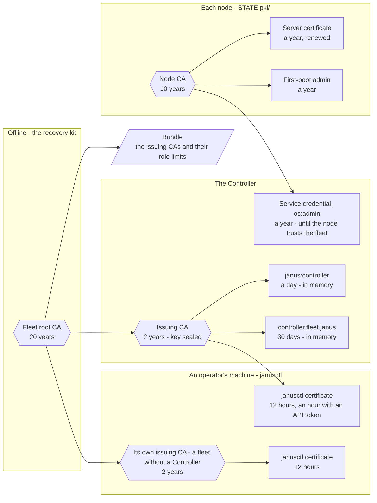
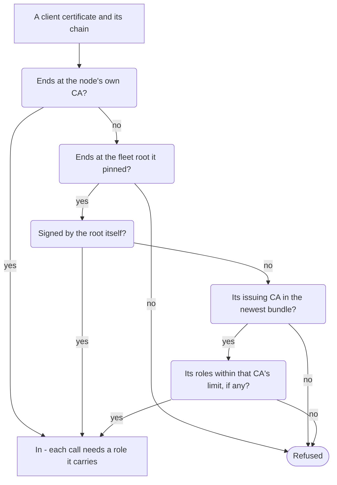

# Trust and certificates

Who proves what to whom in a Janus fleet: every certificate and CA, the
key behind it and where that key lives, how long it lasts, what renews
it, and who checks it. The design behind it - rotation, accounts and
roles, the Controller's fleet - is in the
[architecture](../architecture.md#mtls--pki).

## In short

- **A node's API** (gRPC on port 9505) is mutual TLS. The node shows a
  server certificate signed by **its own CA**; the caller shows a client
  certificate whose Organization is its role - `os:admin`,
  `os:operator` or `os:reader`.
- **A node lets callers in from two roots**: its own CA, always, and its
  **fleet's root**, once it trusts a fleet. The root's key stays offline,
  in a recovery kit. Everyday certificates come from **issuing CAs** the
  root signed - the Controller's, or one per janusctl machine in a fleet
  without a Controller - which a **bundle**, signed by the root too,
  lists.
- **Callers check the node** against the node's CA, which they pinned:
  the Controller when the node registered or was added, janusctl from
  the Controller's inventory or from the fingerprint the node's console
  prints.
- **Outside the node's API**: the Controller has a TLS identity of its
  own, for its registration port and its pages; a release is checked
  against Janus's signing certificate, not a TLS chain.

## Who signs what, and where the keys live

Each box sits where its private key lives. A hexagon is a CA, a
rectangle a certificate; the slanted box is the bundle - signed by the
root, but not a certificate: a list of the issuing CAs nodes accept.

| Certificate | Signed by | Its key | Lifetime | Checked by |
|---|---|---|---|---|
| [Node CA](#the-node-ca) | itself | the node's STATE | 10 years | the Controller and janusctl, which pin it |
| [Server certificate](#the-server-certificate) | the node CA | the node's STATE | a year; renewed 30 days before, and whenever an address or the hostname changes | callers, against the node CA |
| [First-boot admin](#the-first-boot-admin-certificate) | the node CA | printed on the console once, kept on STATE | a year | the node |
| [Service credential](#service-credentials) | the node CA | the Controller, until the node trusts the fleet | a year | the node |
| [Cross-signed CA](#the-cross-signed-ca) | the node's previous CA | the new CA's | the new CA's | clients that pinned the previous CA |
| [Fleet root](#the-fleet-root) | itself | offline, in the recovery kit | 20 years | nodes, which pin it once |
| [Issuing CA](#issuing-cas) | the fleet root | sealed on the Controller, or a file of a janusctl machine | 2 years | nodes, while the newest bundle lists it |
| [`janus:controller`](#the-controllers-certificate) | the Controller's issuing CA | the Controller's memory | a day | nodes |
| [`controller.fleet.janus`](#the-controllers-registration-certificate) | the Controller's issuing CA | the Controller's memory | 30 days | nodes registering, against the fleet root |
| [janusctl's](#janusctl-certificates) | an issuing CA - with the kit, the root | the operator's machine | 12 hours; an hour with an API token or the kit | nodes |
| [The Controller's identity CA](#the-controllers-identity) | itself | sealed on the Controller | 20 years | nodes registering without a fleet, the Let's Encrypt relay's nodes, janusctl contexts that pinned the Controller |
| [The Controller's identity](#the-controllers-identity) | the identity CA | the Controller's data directory | a year; renewed 35 days before | nodes registering without a fleet; browsers and janusctl, unless the pages have a certificate of their own |
| [The pages' certificate](#the-pages-certificate) | your CA | given to the Controller | yours | browsers and janusctl |

## What a node accepts

Once the TLS handshake verified the client certificate's chain, the node
decides:

- **The node's own CA** always lets in, with any role - and only a
  certificate of its own CA can make the node forget its fleet
  (`TrustReset`).
- **A certificate the root signs itself** lets in too: the way back when
  every issuing CA is lost (`janusctl fleet ... -kit`).
- **An issuing CA the newest bundle no longer lists** lets nobody in: a
  bundle is how an issuing CA leaves the fleet, without touching the
  nodes. A bundle can **limit** an issuing CA to roles - one that may
  only sign `os:reader` certificates can't let anyone in as an admin.
- **The role** is the certificate's Organization; every call needs one
  (`internal/rbac`), and every change is logged on the node with who
  made it:
  - a `janus:controller` certificate acts for the user the Controller
    names with each call (`janus-as-user`), with that user's role -
    `automation`, as an admin, for its own background work;
  - a **scoped** certificate (Organization `janus:scoped`) carries a role
    per node in an extension (OID 2.999.1.1, not critical): each node is
    named by the SHA-256 of its CA's public key, and applies its own
    entry.

The node's TLS configuration is built for each connection: a new bundle
counts from the next one. TLS 1.3 only.

## On each node

All of a node's PKI is on its STATE partition, in `pki/` (seen by
janusd as `/etc/janus/pki`). The file API never serves it: its keys
can't be read through the API, by anyone.

### The node CA

- **Made** at the node's first boot (a first boot whose clock reads
  before 2026 waits for NTP first), self-signed, named `Janus node CA:
  <hostname>`.
- **Key**: `pki/ca.key`, on STATE only.
- **Lifetime**: 10 years. Nothing renews it: it is replaced by a
  [rotation](#rotating-a-nodes-ca).
- **Its fingerprint** - the SHA-256 of the certificate - is printed on
  the console at every boot, `pki: this node's CA: SHA-256 <hex>`, and
  in the console's banner: what an operator compares when approving a
  node or adopting it into a fleet.

### The server certificate

- **Signed by** the node CA, for the node's hostname, `localhost`, its
  addresses and 127.0.0.1. Server authentication only.
- **Lifetime**: a year. janusd checks it at start, every 12 hours and on
  every network change, and issues a new one - a new key too - 30 days
  before it expires, or as soon as an address or the hostname changes.
- **Shown** on port 9505, followed by the [cross-signed
  CA](#the-cross-signed-ca) after a rotation.

### The first-boot admin certificate

- **Signed by** the node CA at the first boot: name `admin`, role
  `os:admin`, client authentication.
- **Printed once**, with the CA's certificate and the key, on the
  console - nothing else ever shows it. It also stays on STATE
  (`pki/admin.crt`, `pki/admin.key`), out of the API's reach.
- **Lifetime**: a year. The way in when nothing else is set up: a node
  provisioned with its fleet never needs it.

### Service credentials

An `os:admin` client certificate of the node CA, valid a year, for the
Controller - before the node trusts the fleet:

- **A node added by hand**: the Controller uses the admin credential you
  give it once, to ask the node for a credential of its own
  (`GenerateClientConfiguration`, named `janus-controller`). Yours isn't
  kept.
- **A node registering with a Controller that has no fleet** (or one
  older than the fleet): the node makes the credential - certificate and
  key - and sends it in its registration. A Controller with a fleet
  gets no key: the node sends its CA's certificate, its name and
  address, its token.
- **Deleted** by the Controller as soon as the node trusts the fleet:
  from then on, it holds no credential per node.

`janusctl pki generate-client-config` makes the same kind of
certificate, for any role, for a year at most.

### The cross-signed CA

After a [rotation](#rotating-a-nodes-ca): the new CA's certificate,
signed by the previous one - same key, same lifetime as the new CA. The
node shows it after its server certificate, so a client that pinned the
previous CA still verifies the node; the Controller then pins it in
place of the previous CA. Only the last rotation's is kept.

## The fleet

### The fleet root

- **Made** by the Controller's fleet setup, or by `janusctl fleet init`:
  self-signed, 20 years.
- **Key**: only in the **recovery kit** - an age file, encrypted with a
  passphrase shown once. The Controller deletes its copy once you give
  the kit and the passphrase back; janusctl writes it only into the kit.
- **On the nodes**: `pki/fleet/root.crt`, pinned once - a node refuses
  another root until a certificate of its own CA makes it forget this
  one.

### The bundle

- **What it is**: a version, the date, the issuing CAs' certificates and
  their role limits, signed by the root (ECDSA with SHA-256) - the list
  of the issuing CAs a node accepts.
- **On the nodes**: `pki/fleet/bundle.json`. A node takes a newer
  version only; the same version with other contents is refused.
- **Versions**: a Controller signs one bundle, version 1, at the fleet's
  setup - its root key is gone afterwards. janusctl signs a new one, in
  milliseconds, whenever a machine joins or leaves (with the kit).

### Issuing CAs

- **Signed by** the root, valid 2 years, can sign only leaf certificates
  (path length 0). A node accepts what one signs while the newest bundle
  lists it, within its limit.
- **The Controller's**: made at the fleet's setup, its key sealed in
  the data directory with the Controller's master key. The Fleet page
  shows when it expires.
- **A janusctl machine's**, in a fleet without a Controller: its key a
  file of janusctl's configuration (`issuing.key`, 0600) - `janusctl
  fleet init` on the first machine, `issuer request`, `sign` (with the
  kit) and `accept` on the others; `issuer revoke` signs a bundle
  without one. See [a fleet without a Controller](../fleet-without-controller.md).

## Day-to-day certificates

### The Controller's certificate

`janus:controller`, signed by the Controller's issuing CA: valid a day,
a new key each time, in memory only, renewed when less than 16 hours
are left. Sent with the issuing CA's certificate. Every call names the
user it's made for; the node applies that user's role.

### The Controller's registration certificate

`controller.fleet.janus`, signed by the Controller's issuing CA: valid
30 days, in memory, renewed with 10 days left. The Controller shows it
on its registration port (8443) to a node asking for that name - a node
provisioned with the fleet's root checks the Controller through it,
before it sends anything.

### janusctl certificates

- **From a Controller** (`janusctl login`): signed by its issuing CA for
  a key janusctl keeps (`key.pem`, 0600) - or for your SSH key, with an
  SSH sign-in. Valid 12 hours from a session, an SSH or a browser
  sign-in, an hour from an API token - never past the issuing CA's
  expiry. The account's role, or a scoped certificate when its rights
  differ from node to node. janusctl renews it 5 minutes before it ends
  when it can (a token or the SSH key), else asks you to sign in again.
- **In a fleet without a Controller**: signed on the spot by the
  machine's own issuing CA, valid 12 hours, the context's role -
  refused if the bundle limits that CA below it.
- **With the kit** (`-kit`): signed by the root itself, valid an hour,
  in memory only.

## The Controller's own TLS

### The Controller's identity

A CA of its own, made at the Controller's first start and kept: valid
20 years, its key sealed in the data directory with the master key
(`dashboard-identity-ca.key.sealed`). It signs a certificate for the
Controller's addresses (and `-advertise-address`), valid a year, its
key in the data directory (`dashboard-identity.key`). The Controller
renews that certificate by itself 35 days before it ends - for the
same names, and the addresses it has then - and as soon as
`-advertise-address` names something it doesn't cover.

- **Its registration port** (8443) shows it to a node that doesn't ask
  for `controller.fleet.janus`. A node is given **the identity CA** to
  check the Controller with - by the installer, a seeded image or
  NoCloud (`ca_cert_pem` of the Controller's information, its machines'
  NoCloud); with the fleet's root as well, it tries the fleet first. A
  node never uses the system's trust store there, and never trusts on
  first use. A renewed certificate changes nothing for it.
- **The Let's Encrypt relay** (8444) shows it too: its nodes check the
  relay with the identity CA (`proxy_ca`).
- **Its pages** show it too, unless they have a certificate of their own.
  A janusctl context that pinned the certificate keeps the CA the
  Controller gives it at each sign-in, and takes the next certificate it
  signs.
- **Controllers made before** they kept a CA had only the certificate,
  signed by a CA whose key was thrown away, and gave nodes that very
  certificate. Such a Controller keeps serving it until 35 days before
  it ends, giving the CA *and* that certificate meanwhile, then serves
  one its CA signs. The nodes' relay settings and janusctl contexts
  follow by themselves; what was given that certificate alone and isn't
  a registered node - a seeded image, a saved NoCloud user-data,
  Terraform's or Prometheus's settings - needs the CA instead. The
  Controller says when it switches, in its log and on its Settings page.

### The pages' certificate

Your own, for the main port: given as files (`-tls-cert`/`-tls-key`,
read again when they change) or uploaded on the Controller's page, its
key sealed with the master key. ECDSA or RSA of 2048 bits or more. A
janusctl context pins the Controller by that certificate's fingerprint,
by a CA, or through the system's trust store.

## Getting a node into the fleet

- **Registration with a Controller**: the node announces its CA's
  certificate and, once admitted - a token, or an approval after
  checking the fingerprint against the node's console - takes the
  fleet's trust: the root, then the bundle. A node given the fleet's
  root refuses a fleet with another one.
- **Without a Controller**: `janusctl fleet adopt` sets the fleet on a
  node with its first-boot credential. A node that already lets the
  machine in - its fleet from the first boot, or with the kit - can be
  adopted with the CA fingerprint its console printed instead
  ([a fleet without a Controller](../fleet-without-controller.md)).
- **From the first boot**: the fleet's root and bundle given to the
  installer, a seeded image or NoCloud.
- **By an orchestrator of your own**: the same fleet, kept by your
  PKI - the certificate profile and the bundle's format, as a
  specification: [certificates and the fleet](../private-cloud/orchestrator-certificates.md).

A node never sends its first-boot admin credential anywhere, and the
Controller keeps none of yours.

## Renewal and rotation

- **Renewed by themselves**: the server certificate, the Controller's
  certificate and its registration certificate, the Controller's
  identity, janusctl's certificates (when it can sign in again on its
  own).
- **Not renewed**: the node CA (10 years), the first-boot admin
  certificate and the service credentials (a year), the issuing CAs (2
  years), the fleet root and the Controller's identity CA (20 years).

### Rotating a node's CA

`janusctl access rotate-ca` (or the node's page), as an admin: the node
makes a new CA, the [cross-signed CA](#the-cross-signed-ca), a new
server certificate and a new admin certificate - for a public key you
give, or printed on the console. It writes them aside first and swaps
them in at once; a reboot halfway finishes or drops the rotation. The
previous CA's key is gone: every certificate it signed stops letting in.
The Controller follows the node's new CA by itself.

### Changing the issuing CAs

A new bundle, signed with the kit: an issuing CA joins (`issuer sign`)
or leaves (`issuer revoke`), and every node takes it at its next sync.
With the kit, a machine can also make itself a new issuing CA and a
bundle listing only it (`janusctl fleet recover`): the way back when
every issuing CA is lost.

## Releases

Not TLS: a release's UKI carries an Authenticode signature, which
`Upgrade`, `Install` and kexec check against the certificate built into
janusd - Janus's signing certificate (RSA 4096), the one UEFI Secure
Boot enrolls. It signs the kernel command line, which pins the root
filesystem's dm-verity hash: the whole bundle.

## Algorithms

Every key Janus makes is ECDSA P-256 - nodes, fleet, Controller, the
keys janusctl makes: what every browser and TLS stack accepts (Ed25519
broke Chromium's handshakes with the Controller's pages). Keys it is
given may be others:

- a janusctl certificate for your SSH key: Ed25519 from an agent;
  Ed25519, ECDSA or RSA from a file;
- a key you send to be certified, or the admin key of a CA rotation:
  Ed25519, ECDSA P-256 or P-384, RSA of 2048 bits or more;
- the pages' certificate: ECDSA, or RSA of 2048 bits or more;
- releases: RSA 4096.

## Where the code is

| What | Package |
|---|---|
| The node's CA, certificates, rotation | `internal/pki` (`bootstrap.go`, `servercert.go`, `rotate.go`) |
| The fleet: pinning, bundles, chains | `internal/pki/fleet.go`, `internal/api/access.go` |
| Scoped certificates | `internal/pki/scope.go` |
| Roles per call | `internal/api/authz.go`, `internal/rbac` |
| Registration | `internal/selfregister`, `dashboard/backend/register.go` |
| The Controller's fleet and certificates | `dashboard/backend/internal/fleet`, `dashboard/backend/cli.go` |
| The Controller's identity | `dashboard/backend/internal/identity`, `dashboard/backend/identity.go` |
| The Controller's pages' certificate | `dashboard/backend/internal/uitls` |
| Sealing with the master key | `dashboard/backend/internal/secrets` |
| janusctl's fleet | `cmd/janusctl/fleet.go`, `internal/fleetkit` |
| A release's signature | `internal/releasetrust` |
