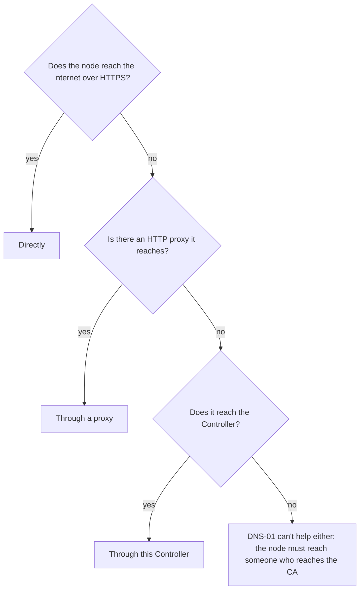

# Let's Encrypt: the letsencrypt extension

Nodes built with the **letsencrypt** [extension](image-factory.md) obtain
their HAProxy certificates from Let's Encrypt - or any ACME CA - and
renew them by themselves. Each certificate is a file HAProxy loads,
`/etc/haproxy/acme/<name>.pem`, and a renewed one is swapped into the
running HAProxy without a reload. It's managed through the API,
`janusctl haproxy acme` and the Controller's **Apps › Let's Encrypt** page.

The extension is `janus-acme`, an ACME client built on
[lego](https://go-acme.github.io/lego/). janusd keeps everything - the
configuration, the account key, the certificates, all on the node's
STATE partition - and runs janus-acme for each exchange with the CA,
handing it only what that exchange needs. janus-acme reads no file of the
node's and keeps nothing.

## A configuration

```json
{
  "account": {
    "directory": "letsencrypt",
    "email": "ops@example.com",
    "accept_terms": true
  },
  "certificates": [
    {"name": "example.com", "domains": ["example.com", "www.example.com", "shop.example.com"]},
    {"name": "wildcard", "domains": ["*.example.com"], "challenge": "dns-01", "dns_provider": "gandi"},
    {"name": "example.fr", "domains": ["example.fr", "www.example.fr"], "challenge": "dns-01", "dns_provider": "ovh"}
  ],
  "dns_providers": [
    {"name": "gandi", "type": "gandiv5", "settings": {"GANDIV5_PERSONAL_ACCESS_TOKEN": "..."}},
    {"name": "ovh", "type": "ovh", "settings": {
      "OVH_ENDPOINT": "ovh-eu", "OVH_APPLICATION_KEY": "...", "OVH_APPLICATION_SECRET": "...", "OVH_CONSUMER_KEY": "..."}}
  ]
}
```

- **account.directory**: `letsencrypt` (the default), `letsencrypt-staging`
  (untrusted test certificates, much higher rate limits - use it while
  setting things up), or another CA's directory URL. For a private CA,
  `directory_ca` is the only CA certificate (PEM) trusted for its HTTPS;
  otherwise the node's trust store is. `eab_key_id`/`eab_hmac_key` are for
  CAs that require external account binding (ZeroSSL, Google...).
- **accept_terms**: registering an account means accepting the CA's terms
  of service. The node registers its account with the first certificate.
- **certificates**: `name` makes the file name; `domains` are the names
  it covers, the first one its subject. `key_type` is `ec256` (the
  default), `ec384`, `rsa2048`, `rsa3072` or `rsa4096`. `challenge` is
  `http-01` (the default) or `dns-01` (with `dns_provider`), which a
  wildcard needs. `profile` picks one of the CA's certificate profiles,
  if it has several (Let's Encrypt's `shortlived`, for 6-day certificates).

Change a certificate's domains, key type or profile, or the CA, and the
node obtains it again. Adding a name to a certificate is a configuration
change, nothing more.

## How the node reaches Let's Encrypt

Obtaining and renewing a certificate means talking to the CA - and, for
DNS-01, to the DNS provider. What leaves the node:

| Traffic | To | Protocol | Through a proxy? | Through the Controller's relay? |
|---|---|---|---|---|
| The ACME API: the account, orders, the certificate, renewal information | the CA (`acme-v02.api.letsencrypt.org`) | HTTPS | yes | yes |
| DNS-01: the provider's API (every provider but `rfc2136`) | `api.cloudflare.com`, OVH, AWS... | HTTPS | yes | yes, but `route53` |
| DNS-01 with `rfc2136`: the record's update | the zone's name server | DNS, port 53 | no | no |
| DNS-01: finding the zone, following a CNAME on `_acme-challenge`, seeing the record appear | the node's resolvers, then the zone's servers | DNS, port 53 | no | no |

Each node chooses how it reaches the CA:

| | Who talks to the CA | What must be open | The account key and DNS secrets |
|---|---|---|---|
| **Directly** (the default) | the node | the node reaches the CA over HTTPS, and the DNS provider's API for DNS-01 | on the node |
| **Through a proxy** | the node, through an HTTP(S) proxy | the node reaches the proxy, the proxy reaches the CA and the providers' APIs | on the node |
| **Through this Controller** | the node, through the Controller's relay - encrypted end to end | the node reaches the Controller, the Controller reaches the CA and the providers' APIs | on the node; the relay holds none |



Whichever it is, an HTTP-01 challenge needs the CA to reach the node on
port 80 from the internet ([HTTP-01: HAProxy answers](#http-01-haproxy-answers));
DNS-01 doesn't. The Controller's **Apps › Let's Encrypt** page shows the
choice first, with what this node's certificates need open, and a
**Test** button that fetches the CA's directory that way and says how it
went - before or after saving.

### Directly

Nothing to set: the node reaches the CA, and the DNS providers' APIs, on
its own routes - its default gateway, an HTTPS egress your firewall lets
through.

### Through a proxy

For a node whose only way out is an HTTP proxy (Squid, a company's
proxy): the ACME API and the DNS providers' APIs go through it, in an
HTTPS tunnel (`CONNECT`) - the proxy sees which host the node reaches,
not what it says. On the page, **Through a proxy**: the proxy's URL, a
username and password if it asks for them, and for an `https://` proxy
whose certificate the node's trust store doesn't know, its CA. Or:

```sh
janusctl haproxy acme test-path proxy http://proxy.example.net:3128   # try it first
janusctl haproxy acme path proxy http://proxy.example.net:3128 -user acme -password-file pw.txt
janusctl haproxy acme path                                             # how the CA is reached now
janusctl haproxy acme test-path                                        # try the saved way
janusctl haproxy acme path direct                                      # back to directly
```

In the configuration's JSON, it's `path`:

```json
{
  "path": {
    "mode": "ACME_PATH_MODE_PROXY",
    "proxy_url": "https://proxy.example.net:8443",
    "proxy_username": "acme",
    "proxy_password": "...",
    "proxy_ca": "-----BEGIN CERTIFICATE-----..."
  }
}
```

- **proxy_url**: `http://` or `https://` with a host and a port - the
  credentials go apart, not in the URL. **proxy_password** is a secret:
  it never comes back (`haproxy acme get`, the page), and left empty it
  keeps the saved one.
- **proxy_ca** is the proxy's own CA, for its certificate only: the CA's
  certificate is still checked against `directory_ca` or the node's
  trust store, inside the tunnel.
- **What a proxy can't carry**: DNS. DNS-01's lookups - finding the zone,
  seeing the record appear - go from the node to its resolvers, which
  must answer for public names; `propagation_wait_seconds` waits instead
  of looking for the record. An `rfc2136` provider updates its name
  server directly, on port 53.
- **The DNS providers**: the provider's own client goes through the
  proxy too, with its CA. `route53`'s - the AWS SDK's - takes the proxy
  from its URL alone: through an `http://` proxy, or an `https://` one
  the node's trust store knows.
- The node keeps its path apart from the rest of the configuration
  (`config/acme/path.json`, beside the account key): a node rolled back
  to a version without it keeps its certificates' configuration, and
  reaches the CA directly.

### Through the Controller's relay

For a node that reaches its Controller but nothing else: the Controller
relays its HTTPS to the CA and to its DNS provider's API. The relay is
an `https://` proxy on the Controller (port 8444 by default) that only
tunnels: the node's TLS to the CA runs inside, end to end - the relay
sees which host the node reaches and how many bytes, never what it
says, and holds none of the node's secrets. It knows the node by a
certificate of the node's own CA, made for each request: only a node
added to this Controller gets through, and only to the CA's and the DNS
providers' API hosts - or what an admin allows besides.

An admin turns the relay on, on the Controller's **Let's Encrypt** tab
([The Controller and Let's Encrypt](guide/letsencrypt-controller.md)).
Then, on the node's page, **Through this Controller**: the relay's
address and the Controller's identity come with the choice - nothing to
type. Or, with the address and the identity that tab shows:

```sh
janusctl haproxy acme path controller https://controller.example.net:8444 -ca controller-identity.pem
janusctl haproxy acme test-path
```

In the configuration's JSON, `proxy_url` is the relay's address and
`proxy_ca` the Controller's identity:

```json
{
  "path": {
    "mode": "ACME_PATH_MODE_CONTROLLER_RELAY",
    "proxy_url": "https://controller.example.net:8444",
    "proxy_ca": "-----BEGIN CERTIFICATE-----..."
  }
}
```

- **The Controller must be running** for a certificate to be obtained
  or renewed. A certificate lasts 90 days and is renewed from day 60:
  a Controller down for a few days changes nothing; the node retries.
- **DNS-01**: the providers whose API the relay knows go through it -
  the tab lists them. `httpreq` and `pdns` reach the API their settings
  name: an admin allows that host. `route53` can't go through the relay
  (the AWS SDK doesn't present the node's certificate), nor `rfc2136`
  (DNS); and DNS-01's lookups still go from the node to its resolvers.
- A node moved, or a Controller whose relay address changed: the node's
  page says so and offers the new address.

## HTTP-01: HAProxy answers

An HTTP-01 challenge asks `http://<domain>/.well-known/acme-challenge/<token>`
for `<token>.<account thumbprint>`. HAProxy answers it itself, for every
domain and every token, with one rule - nothing to put in place per
challenge:

```haproxy
frontend http
    bind :80
    http-request return status 200 content-type text/plain lf-string "%[path,field(-1,/)].${JANUS_ACME_THUMBPRINT}" if { path_beg /.well-known/acme-challenge/ }
    http-request redirect scheme https code 301

frontend https
    bind :443 ssl crt /etc/haproxy/acme/ strict-sni
    ...
```

janusd starts HAProxy with the account's thumbprint in
`JANUS_ACME_THUMBPRINT`; `janusctl haproxy acme status` shows it and the
rule. The rule goes before any redirect, in each frontend on port 80 that
receives the challenges. HAProxy must be reachable on port 80 from the
internet for these names - otherwise use DNS-01.

## The certificate files

Every configured certificate is `/etc/haproxy/acme/<name>.pem` (chain and
key). Until the CA's certificate is there, the file holds a self-signed
stand-in for the same names, so a configuration that references it loads
from the start. The usual order is: save the letsencrypt configuration,
then the HAProxy configuration that uses the files and answers the
challenges. Applying a HAProxy configuration makes the node retry at once
the HTTP-01 certificates it couldn't obtain yet.

Reference a file (`crt /etc/haproxy/acme/example.com.pem`), or the whole
directory (`crt /etc/haproxy/acme/`), possibly after a default
certificate. A renewed certificate is swapped into the running HAProxy
through its runtime API, without a reload. A certificate obtained for the
first time after HAProxy started can't be swapped into a directory
HAProxy has already read: janusd reloads HAProxy then (seamlessly).

Removing a certificate from the configuration removes its file - refused
while haproxy.cfg doesn't load without it: take it out of the HAProxy
configuration first.

## Renewal

- A certificate is renewed when a third of its lifetime is left (30 days
  of a 90-day certificate), or earlier when the CA's ACME Renewal
  Information (RFC 9773) says so - Let's Encrypt uses it to have
  certificates renewed early, e.g. before a mass revocation. The node asks
  once a day, and renews at a random time in the window the CA gives.
- After a failure the node waits 5 minutes, then twice as long after each
  new failure, up to a day: Let's Encrypt allows 5 failed validations per
  name and hour.
- `janusctl haproxy acme renew [NAME...]` (and **Renew** in the
  Controller) obtains certificates now, due or not.

## DNS-01: DNS providers

For wildcards, or names HAProxy doesn't receive on port 80, janus-acme
creates the `_acme-challenge` TXT record through the DNS provider's API.
`settings` are lego's own variables for that provider - see lego's page
for each (go-acme.github.io/lego/dns/&lt;type&gt;):

| type | usual settings |
|---|---|
| `gandiv5` | `GANDIV5_PERSONAL_ACCESS_TOKEN` |
| `ovh` | `OVH_ENDPOINT` (`ovh-eu`), `OVH_APPLICATION_KEY`, `OVH_APPLICATION_SECRET`, `OVH_CONSUMER_KEY` |
| `cloudflare` | `CLOUDFLARE_DNS_API_TOKEN` |
| `route53` | `AWS_ACCESS_KEY_ID`, `AWS_SECRET_ACCESS_KEY`, `AWS_REGION`, `AWS_HOSTED_ZONE_ID` |
| `pdns` (PowerDNS) | `PDNS_API_URL`, `PDNS_API_KEY` |
| `rfc2136` (dynamic DNS updates: BIND, Knot...) | `RFC2136_NAMESERVER`, `RFC2136_TSIG_KEY`, `RFC2136_TSIG_SECRET`, `RFC2136_TSIG_ALGORITHM` |
| `hetzner` | `HETZNER_API_TOKEN` |
| `digitalocean` | `DO_AUTH_TOKEN` |
| `scaleway` | `SCALEWAY_API_TOKEN`, `SCALEWAY_PROJECT_ID` |
| `ionos` | `IONOS_API_KEY` |
| `infomaniak` | `INFOMANIAK_ACCESS_TOKEN` |
| `desec` | `DESEC_TOKEN` |
| `httpreq` (your own webhook) | `HTTPREQ_ENDPOINT`, `HTTPREQ_USERNAME`, `HTTPREQ_PASSWORD` |

Only a provider's own variables are accepted, and never a `*_FILE` one
(there's no file to read on the node).

Before asking the CA to check the record, janus-acme checks that it's
visible on the zone's authoritative servers. With split-horizon DNS -
the node's resolvers serve an internal view of the zone - give public
resolvers for that check (`"resolvers": ["1.1.1.1", "9.9.9.9"]`), or, if
the node can't query them, wait a fixed time instead
(`"propagation_wait_seconds": 60`).

## Secrets

The DNS providers' settings, the EAB key and a proxy's password are secrets: the node keeps
them (on STATE, mode 0600) and never gives them back. `janusctl haproxy
acme get` and the Controller show them empty; an empty value in an
applied configuration keeps the saved one. To change one, give the new
value; to remove one, leave it out.

## The account key

The node creates its account key (ECDSA P-256) the first time. To keep
using an existing account - its rate limits, and the thumbprint an
existing HAProxy rule may already use - give its private key (PEM, EC or
RSA):

```sh
janusctl haproxy acme apply -account-key account.key letsencrypt.json
```

acme.sh keeps it in `<acme.sh home>/ca/acme-v02.api.letsencrypt.org/directory/account.key`
(`acme-staging-v02...` for the staging account). HAProxy is reloaded, for
its `JANUS_ACME_THUMBPRINT` to follow.

## Several nodes

Behind VRRP or anycast, the challenge may reach any of the nodes. With
HTTP-01, give them all the same account key: they then answer every
challenge alike. Each node obtains its own certificates: mind the CA's
limits (Let's Encrypt: 5 certificates for the exact same set of names per
week) - or use DNS-01.

## Applying

```sh
janusctl haproxy acme check letsencrypt.json    # checked, nothing changes
janusctl haproxy acme apply letsencrypt.json    # saved; certificates are obtained in the background
janusctl haproxy acme status                    # the account, each certificate's state, expiry, last error
janusctl haproxy acme get > letsencrypt.json    # the configuration, secrets empty
janusctl haproxy acme renew example.com         # now
```

The log is the `letsencrypt` service log (`janusctl system logs
letsencrypt`, Logs in the Controller).

## Monitoring

The [Janus exporter](metrics.md) reports `janus_acme_certificate_state`
(`pending`, `valid`, `due`, `expired`), `janus_acme_certificate_failures`
(in a row), `janus_acme_certificate_renew_timestamp_seconds`,
`janus_acme_certificate_last_success_timestamp_seconds` and
`janus_acme_account_registered`; the certificates' expiry is in
`janus_certificate_expiry_timestamp_seconds{source="haproxy"}` like every
certificate HAProxy loads. Alert on failures that last, not on one.

## Moving from acme.sh

A HAProxy that used acme.sh in stateless mode (`setenv ACCOUNT_THUMBPRINT`
and the same `http-request return` rule) moves with its account and its
rule:

1. Import acme.sh's account key (above): the thumbprint stays the same.
2. One certificate per acme.sh certificate, with the same names (`acme.sh
   --list`, `acme.sh --info -d <domain>`).
3. In haproxy.cfg, `${ACCOUNT_THUMBPRINT}` becomes
   `${JANUS_ACME_THUMBPRINT}` - janusd puts the thumbprint in HAProxy's
   environment - and the `setenv ACCOUNT_THUMBPRINT` line goes: a node
   refuses `setenv` in the global section
   ([haproxy-config.md](haproxy-config.md#the-global-section)). Point the
   `crt` lines at `/etc/haproxy/acme/`.
4. A wildcard issued elsewhere (DNS-01 by hand) becomes a `dns-01`
   certificate with the zone's DNS provider: renewed by the node from then
   on.

## Other certificates

A certificate from another CA (an internal one, a commercial one) goes in
[HAProxy's files](haproxy-files.md) and is referenced from there.

## Not supported

The TLS-ALPN-01 challenge, revoking a certificate, OCSP (Let's Encrypt
has stopped it), and DNS providers that need a program or a file (lego's
`exec`, `manual`).
